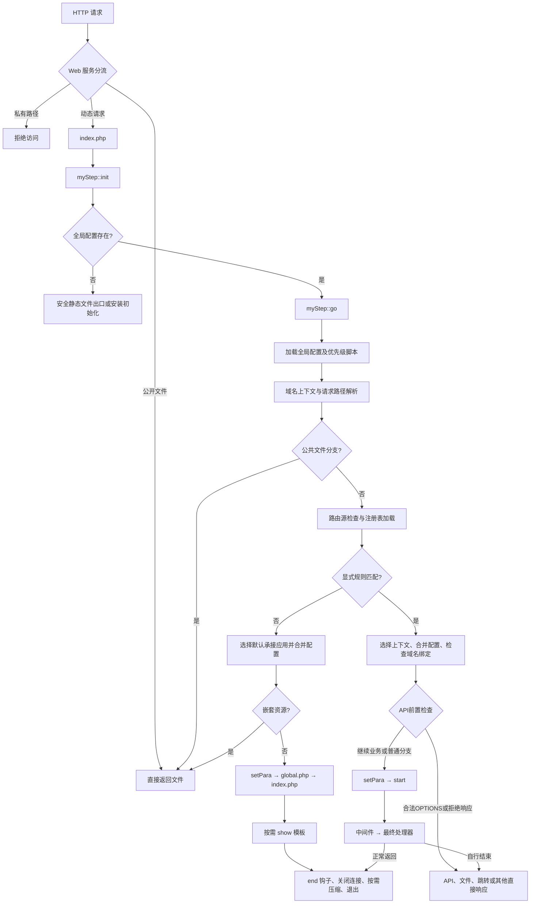

# 请求总流程与分支

## 本篇目标与调用场景

按当前源码的条件与顺序说明本阶段；特别标明哪些分支会提前结束，哪些变量和钩子尚未可用。

## 先判断请求属于哪条链

```text
公开文件：Web服务器直接返回，或go中的文件出口 → 结束
普通页面：init → go → 选择应用 → setPara/start → global → index → 模块 → show → end
显式页面：init → go → 路由命中 → setPara/start → 中间件 → 处理器 → 普通end或处理器自己的出口
页面模块：路由命中 → setPara/start → getModule → 主模板 → global → 选中模块 → show → end
HTTP API：路由命中 → API前置检查 → setPara/start → api → 登记的目标 → 编码输出 → exit
API预检：路由命中 → API前置检查 → 合法OPTIONS返回204 → 结束
```

以上名称表示调用阶段。`module/index.php`是否运行由应用入口决定；`start()`已在进入默认应用`index.php`之前执行。路由匹配不会自动让显式处理器先经过应用`index.php`。

## 公共启动时序

| 顺序 | 调用或文件 | 执行内容 | 开发时可依赖的状态 |
| --- | --- | --- | --- |
| 1 | 根`index.php` | 检查PHP版本，定义`ROOT/LIB/APP/CACHE/CONFIG/PLUGIN/STATICS/VENDOR/FILE`，加载myStep并调用init | 目录常量；尚无当前应用 |
| 2 | `myStep::init()` | 建立缓冲和类加载，执行已解析输入预算检查；需要时清理重建后的编译缓存 | 框架类可加载；没有常规会话和身份 |
| 3 | init后半段 | 定义`ROOT_WEB`，设置初始异常处理；缺少全局配置则进入初始化安装分支 | Web根路径和基础日志 |
| 4 | `myStep::go()` | 读取全局配置，准备存储及API全局设置，处理feed规范地址跳转 | `$ms_setting`是全局配置；尚未合并当前应用 |
| 5 | `config/priority/` | 先执行有效应用前置脚本，再按活动插件order降序执行插件前置脚本 | 可读取全局设置；不假定`PATH/$mystep`或登录身份存在 |
| 6 | go | 设置运行内存策略，解析Host、域名虚拟前缀及API专属域名，建立路由对象 | `$router`已有解析路径；应用信息仍可能被规则改写 |
| 7 | go文件分流 | 拒绝私有路径，校验并返回公共文件或缺失资源占位内容 | 命中文件分支时不会启动页面服务 |
| 8 | go动态分支 | 补齐Cookie作用域及站点URL，登记变量别名，刷新并加载路由表 | 初步`$info_app`可用；并非最终应用上下文 |
| 9 | 路由或默认承接 | 选定应用、合并应用配置并执行域名检查；显式规则还可合并入口覆盖配置 | 当前应用确定；尚未调用处理器 |
| 10 | `myStep::setPara()` | 检查关闭状态，定义`PATH`，创建核心对象、加载lib并执行preload，准备资源和模板参数 | 创建过程的先后条件见下表 |
| 11 | `$mystep->start()` | 准备服务、语言、Cookie、Session、CSRF和身份，再按条件初始化插件及start钩子 | 业务入口可使用准备完成的资源，并自行检查权限 |
| 12 | 页面／处理器 | 运行当前分支的入口或回调 | 具体页面、API和文件出口各自决定响应 |

`route.php`在路由汇总时提供声明，框架可以复用已编译的`config/route.php`。不要将每次请求必做的工作放在路由声明文件顶层。

## 应用对象建立的准确顺序

```text
setPara
  → 已有$mystep时直接返回
  → 按最终应用判断公共端点的会话策略
  → checkClose
  → PATH = 当前应用目录
  → 加载同名核心文件并选择myStep子类
  → new 当前核心：构造函数绑定$ms_setting、设置时区及超时
  → 应用lib.php（存在时）
  → preload（可调用时）
  → 收集公共／应用／风格资源
  → 建立$tpl_setting、$tpl_cache
  → start
```

`preload()`适合登记回调、准备控制器路由或按应用需求补充配置。此时默认的`setInstance()`、语言包、Session、登录恢复都尚未执行；应用自行提前建立的资源是该应用的明确行为，不是每个应用都有的保证。`preload()`内也不能假定框架尚未建立的`$tpl_setting`已经可用。

`lib.php`在核心实例创建之后加载。如果同名核心文件顶层依赖其他类或接口，核心文件须明确加载其依赖，不能等待之后的`lib.php`再补齐。核心类文件可以提前`require_once`应用lib，但声明文件不在顶层产生页面输出。

## start内部的准确顺序

1. 记录耗时与内存起点，设置类别名及完整错误处理。
2. 读取当前应用的`plugin.php`绑定，与活动插件注册表取交集，按order降序去重登记。此处只是登记，尚未执行插件`index.php`。
3. 未声明登录回调时设置框架默认login/logout/chg_psw。
4. 调用`setInstance()`，复用或创建`$cache`和`$db`。`db.auto`开启时才自动连接业务数据库；对象存在不代表连接成功或已选库。
5. 补充Cookie前缀、文件会话目录、请求时间及Host信息。
6. 先加载框架语言，再加载当前应用语言。
7. `myReq::init()`配置Cookie与Session，设置所选会话驱动并启动会话；不需会话的公共框架端点按其策略处理。
8. `mySecurity::guard()`校验操作方法和会话CSRF；随后`login()`恢复框架认证状态。
9. 合并功能忽略列表，清空页面start/end内容槽，准备当前URL前缀。
10. 父类start设置字符集、HTML基础响应头和输出缓冲。
11. 当前入口允许插件时，按登记顺序包含对应插件`index.php`；插件可使用宿主`$this`登记钩子、标签及资源。
12. 按登记顺序执行`start`钩子，返回当前请求分支。

框架管理员身份恢复与普通会员登录是不同服务。即使start已返回，处理器仍需检查当前用户是否有权执行该项业务。插件的`check/install/uninstall`不是普通页面的每请求阶段。

## 默认页面如何装配

请求`/Hello/`，没有显式规则接管且应用Hello存在时：

```text
go选择Hello → 合并Hello/config.php → 域名检查
→ setPara/start完成
→ 设置$m为剩余路径首段
→ require_once Hello/global.php（存在时）
→ require Hello/index.php
→ 由该index选择并包含自己的module
→ 模块为子模板赋值，render得到字符串
→ 将子页面放入主模板main
→ 返回go，存在$tpl时调用show
→ go调用end并结束
```

框架只负责读取应用`index.php`，并不自动给任意应用添加同名模块分派。`index.php`要明确选择模块与模板。默认入口已经交给外层show时，不再重复手工show，否则会输出两份页面。

## 显式规则和中间件

匹配先扫描原请求路径，未命中时再扫描带域名虚拟前缀的路径；每轮按规则登记顺序取首个命中。两轮都未命中才进入默认应用。

命中后更新`$info_app`、合并配置、检查域名，随后执行setPara/start，再调用中间件及最终处理器。因此“规则已匹配”和“处理器已执行”是两个时刻。

中间件返回严格`false`时停止后续处理器，路由仍视为已处理，不再回退到应用首页。中间件自行设置拒绝响应；若没有exit，外层仍可能继续普通end收尾。普通命名处理器不自动执行应用`global.php/index.php`，需要的数据在处理器覆盖的阶段准备。

`getModule()`是独立页面分发器：先建立主模板，再包含global，按当前风格和模块路径候选顺序选文件；模块设置了`$content`才赋入main并show，之后方法内end。它与业务应用自行写在index中的module分派分开使用。

## API与公共端点

API匹配后，启用状态、来源、正文预算与OPTIONS预检先于完整应用启动处理。合法预检可直接返回204；实际业务调用继续setPara/start，再由`myStep::api()`解析已登记范围、处理器、位置参数及格式。

实际API只调用登记目标，编码响应后exit，不经过普通HTML模板show和普通end。目标插件的独立API类按需要加载，不能把目标插件`index.php`当作必经初始化；宿主start是否初始化其绑定插件，另由宿主绑定和功能忽略规则决定。

API处理器应返回业务数据，不直接echo调试文字。该API出口会取出已产生的缓冲内容，存在内容时可能用它覆盖编码结果；声明文件、preload及钩子中的输出也会影响JSON。

## 页面生成与收尾

```text
render(子模板) → 返回字符串，不自动输出完整页面
show(主模板)
  → 框架页面变量
  → page_start首位的公开setting/language
  → CSS/JS资源及page_end的DOM就绪队列入口
  → 模板渲染
  → page钩子：正文依次传递，回调返回修改后的正文
  → 当前会话的CSRF装饰 → 输出 → shown=true
end
  → 逆序end钩子 → 可选shutdown
  → 编辑器附加资源准备
  → 关闭数据库并统计耗时/内存
  → 清理db/cache全局引用
  → shown为true时按响应条件处理压缩
  → exit
```

`setFunction('start', ...)`登记的是PHP钩子，`setAddedContent('start', ...)`登记的是HTML内容槽。`page_start/page_end`的位置由模板决定；浏览器脚本是在浏览器收到HTML后执行，不与PHP钩子交错运行。

页面主动调用`checkCache($tpl)`且命中时，会刷新公开浏览器状态、加入当前会话装饰，输出后end；后续页面查询及重新渲染不再执行。模板编译缓存命中只复用编译结果，仍会继续当前渲染，不等于页面缓存命中。

## 代码应该放在哪个阶段

| 工作 | 推荐位置 | 不宜依赖的条件 |
| --- | --- | --- |
| 共享类、函数声明 | 应用lib.php／插件class.php | 不在文件顶层执行安装和业务写入 |
| 路由及API登记 | 应用或插件route.php | 不假定它每次动态请求都会重新执行 |
| 全局请求前置过滤 | 已安装的priority.php | 没有普通应用会话，不能检查尚未恢复的登录身份 |
| 为start/page/end登记回调 | preload或插件index.php | 业务模块才登记start钩子时，本次start阶段已经过去 |
| 登录后通用准备 | start钩子 | 仍需区分框架管理员和普通会员 |
| 页面查询、参数处理、模板赋值 | 对应模块／显式处理器 | 默认global和index不覆盖所有API及文件出口 |
| 多模块公用页面数据 | global.php，或由相关处理器显式调用的公共函数 | 不能用global保护所有路由 |
| 输出正文处理 | page钩子 | 返回正文；API和文件不保证执行它 |
| 请求局部资源释放 | 使用资源的try/finally | end不是所有分支都必经的finally |

## 变量何时可以使用

| 标识 | 开始可用的阶段 | 使用说明 |
| --- | --- | --- |
| ROOT等目录常量 | 根index | 磁盘位置；不要当浏览器URL |
| ROOT_WEB | init | 部署Web根前缀 |
| $ms_setting | go读取全局配置后 | 最终值还会随应用、入口及应用自定义合并而变化 |
| $router | go建立路由对象后 | 规则匹配前的信息属于初步解析 |
| $info_app | 动态分支及路由选择后 | 业务入口使用最终app/path/para/route |
| PATH、$mystep | setPara选定应用及建立实例后 | preload中已有这两项 |
| $tpl_setting、$tpl_cache | preload返回后 | 模板参数不等于模板对象已经创建 |
| $db、$cache | 默认setInstance返回后 | 可被应用提前建立；数据库连接由db.auto及显式调用决定 |
| 语言、Session、恢复后的认证状态 | start中对应步骤完成后 | 正常start钩子已处于该阶段之后 |
| $tpl、$tpl_sub、$content | 页面入口／模块显式创建后 | 是页面约定，不是所有请求都有的全局变量 |

## 按请求观察实际顺序

完整可操作的记录示例见[应用执行顺序](../../development/app/app-07.md)。先准备Hello应用，在preload登记三个钩子，再分别访问默认页面、命名路由和API；对照是否执行global、index、page及end。不要通过临时修改框架核心或在JSON响应里echo来跟踪调用。


## 1. 框架分层与主要职责

| 层次 | 核心位置 | 职责 |
| --- | --- | --- |
| HTTP 服务层 | Web 服务配置 | 将动态请求交给统一入口；直接处理允许公开的文件；保护代码及私有数据 |
| 统一入口 | `index.php` | 定义目录常量，载入框架，调用初始化方法 |
| 请求调度层 | `lib/myStep.class.php` | 初始化、配置合并、文件分流、应用上下文、认证启动、响应生命周期 |
| 路由层 | `lib/myRouter.class.php` | 解析请求路径、编译规则、按优先级匹配、执行中间件和处理器 |
| 控制器基础层 | `lib/myController.class.php` | 对象实例、别名、认证回调、资源收集、模块注册、钩子和基础响应 |
| 请求与认证层 | `lib/myReq.class.php`、`lib/myAuth.class.php` | 输入访问、Cookie、Session、密码验证、记住登录令牌 |
| 配置与基础服务层 | `myConfig`、`myCache`、`myDb` | 配置对象、缓存驱动、数据库连接与查询 |
| 输出层 | `myTemplate`、`myApi`、文件输出方法 | 页面渲染、API 结果转换、文件响应及输出压缩 |
| 框架内置入口 | `app/myStep/route.php` 等 | 后台入口规则和公共 API、模块、语言、设置、验证码、错误处理入口 |

框架并非每个请求都会建立完整页面上下文。静态资源、跳转、安装初始化、API 及部分模块具有不同的结束路径。

## 2. 总体执行流程



这个流程图表示调度关系。错误处理、关闭站点、权限中间件、页面缓存等均可能在相应阶段提前终止请求。

## 3. 入口阶段：index.php

统一入口按以下顺序执行：

1. 检查 PHP 最低版本。当前入口对低于 PHP 8.5.12 的版本直接终止；Composer约束为^8.5.12。
2. 根据入口文件目录定义 `ROOT`，并统一目录分隔符。
3. 定义各功能目录常量。
4. 加载 `LIB.'myStep.class.php'`。
5. 调用 `myStep::init()`。

| 常量 | 表示的目录 |
| --- | --- |
| `ROOT` | 框架根目录 |
| `LIB` | 核心类库 |
| `APP` | 应用与框架内置入口 |
| `CACHE` | 运行缓存 |
| `CONFIG` | 全局配置及生成的索引 |
| `PLUGIN` | 扩展代码及注册信息 |
| `STATICS` | 公共静态资源 |
| `VENDOR` | Composer 依赖 |
| `FILE` | 上传或文件业务使用的目录 |

载入 `myStep.class.php` 时，同时加载公共函数、Composer 自动加载入口和控制器基类。框架自己的类加载器在随后的 `init()` 中注册。

## 4. init：类加载、输入预算与基础上下文

注册框架类加载器、检查已解析输入预算、建立ROOT_WEB与初始错误处理，再选择安装或正常go分支。此时没有普通应用会话；优先级及错误边界见[初始化](bootstrap.md)。

## 5. go：全局配置、优先脚本与文件分流

加载全局配置及活动存储配置，处理域名上下文和优先脚本，建立路由对象。受保护目录先拒绝；公开文件可以直接返回，动态请求才继续。详见[请求准备](dispatch.md)。

## 6. 路由源与注册表

应用和插件的route.php用于声明，源指纹改变时刷新生成表；普通页面不应直接编辑config/route.php。占位格式按当前组生效，捕获参数另见[路由](../routing/routing.md)及[格式](../routing/route-formats.md)。

## 7. 显式规则与默认入口

先扫描原路径规则，再扫描有效域名前缀路径；每轮首条命中有效。两轮均未命中才使用默认应用入口，不是看到同名app目录就跳过显式规则。命中后先合并当前应用和入口覆盖，再启动处理器。

## 8. 域名及接口前置检查

checkBind按配置决定是否跳转；非GET/HEAD跳转保留方法。API的总开关、所有格式正文上限及CORS预检可以在完整应用启动前结束请求，详见[API边界](../api/api.md)。

## 9. setPara与start：应用准备和服务启动

setPara先建立同名核心对象，再加载lib.php、调用preload、准备资源与模板参数，最后start。start才依次准备服务、语言、Session、CSRF、身份恢复、插件初始化和start钩子。不要在preload中假定用户已登录；精确条件见[应用启动](application-start.md)。

## 10. 页面模块、注册模块和API

默认页面加载global.php与index.php；getModule创建主模板、加载global.php并选择页面module；module分发显式登记的文件或回调；api只运行已注册接口。它们是不同协议，不共享一个“总是执行”的入口或结束钩子，见[模块分发](../routing/route-modules.md)。

## 11. 页面、模板、钩子与结束流程

### 11.1 render() 与 show()

| 方法 | 行为 |
| --- | --- |
| `render()` | 补充路径、语言和标签信息，返回渲染内容，供组合页面使用 |
| `show()` | 补充页面及路径变量，准备合并 CSS/JS，注入页面内容，渲染并实际输出 |
| `checkCache()` | 缓存命中后刷新公开setting/language、注入当前会话 CSRF 信息并输出，再立即调用 `end()` |

`show()` 的核心顺序为：在应用追加脚本前提供公开setting/language → 框架补充公共模板变量 → 收集页面起止内容及资源标签 → 父类注入语言和自定义标签 → 模板渲染 → `page` 钩子处理渲染结果 → 输出 → 标记 `shown=true`。

模板编译缓存、页面 HTML 缓存、数据缓存、数据库查询缓存及合并脚本缓存是不同层次。仅调用 `show()` 不等于已经执行页面缓存命中检查；`checkCache()` 需要由相应页面流程调用。

### 11.2 通用扩展与钩子顺序

扩展登记、扩展初始化、钩子执行是三个不同步骤。活动注册信息在单次请求中读取后复用；功能忽略列表可跳过扩展初始化，但已登记的通用控制器钩子仍按代码调用点执行。

| 钩子 | 调用位置 | 默认执行顺序 |
| --- | --- | --- |
| `start` | 完整服务及认证启动之后 | 登记顺序 |
| `page` | 页面渲染之后、正文输出之前 | 登记顺序，页面参数（包括空串及 0）沿链传递 |
| `end` | 普通页面结束阶段 | 逆登记顺序 |

钩子处理器可以修改输出或自行结束请求。单个可调用数组 `[对象, 方法]` 与回调列表分别处理。`run()` 省略第三参数时向钩子传当前控制器；显式传第三参数时保持管道语义，即使值为 `""`、`"0"`、`0`、`false` 或 `null`，也不会中途改传控制器。数组按位置展开。

### 11.3 end() 与压缩

普通页面的 `myStep::end()` 顺序为：

1. 父类执行逆序 `end` 钩子。
2. 调用可选 `shutdown()`。
3. 存在延迟跳转目标且缓冲区无内容时，可直接跳转。
4. 准备编辑器相关扩展脚本缓存。
5. 关闭数据库并取得查询统计，计算耗时和内存峰值。
6. 清理数据库和缓存全局引用。
7. `shown=true` 时进入 `gzOut()`。
8. 退出当前请求。

`gzOut()` 根据 Accept-Encoding 及其质量参数、配置压缩级别、响应头是否发送、连接状态等决定压缩或原样输出，并设置对应的缓存协商响应头。不要将“请求结束”理解为“一定 gzip”。页面缓存直接输出、API、文件、跳转等路径也不一定进入这里。

## 12. URL 生成、错误与提前退出

### 12.1 setURL()

`setURL()` 生成框架链接，不执行路由匹配。它将路径与 `?query`、`#fragment` 分离，只规范化路径：

- `rewrite`：`ROOT_WEB + 路径`。
- `path_info`：`ROOT_WEB + index.php + 路径`。
- `query_string`：`ROOT_WEB + index.php? + 路径`，原查询参数改以 `&` 接续。

绝对 URI、协议相对地址及已包含入口文件的路径具有保持原样的处理分支。路径重写不应修改查询参数中的 URL 或重复斜杠。

### 12.2 错误处理

错误处理分为初始化期处理器和完整运行期处理器。`myStep::header()` 为 403、404、500 设置真实 HTTP 状态；框架对象尚未创建时安全调用父类响应，不依赖语言包或模板对象。

对象已经创建时，部分错误通过框架信息提示页输出。提示页、返回值错误信息及 HTTP 状态是不同概念，处理器应明确自己使用哪一种协议约定。

### 12.3 文件与条件响应

`myController::file()` 打开本地文件，以流式 SHA-256 生成内容 ETag，再流式输出原始字节；不经过移除 BOM 的文本读取方法。默认输出缓冲在发送前清理，已有 `ob_gzhandler` 按分块缓冲恢复。HEAD 只发送头部；文件不存在返回 404。所有正常文件出口均立即结束请求，大文件不会落入后续路由或附加页面内容。

文件长度来自打开的文件；无压缩/自定义输出转换时设置 Content-Length。文件名过滤控制字符并通过 filename/filename* 编码。文件响应输出实际 Last-Modified；当前出口返回完整文件，不实现 Range 分段响应。

`etag()` 统一输出带引号标签，GET/HEAD 支持多个 If-None-Match、弱标签及星号，命中时输出无正文 304；POST 等方法不会误回 304。内容摘要可识别同秒同长度替换，代价是在发送前多读一次文件；公开静态资源优先由 Web 服务直接处理。

### 12.4 提前结束矩阵

| 请求或行为 | 是否通常完整启动服务 | 是否通常执行页面 end |
| --- | --- | --- |
| Web 服务直接返回文件 | 否 | 否 |
| 框架公共文件出口 | 否 | 否 |
| 默认入口嵌套 asset | 否，已加载入口配置 | 否 |
| 安装初始化 | 独立流程 | 不统一保证 |
| 路由命中后正常返回 | 是 | 是，除非处理器已经退出 |
| 默认入口普通页面 | 是 | 是，除非入口自行退出 |
| `getModule()` 页面模块 | 是 | 方法内调用 |
| 注册 API | 是 | 否，API 内退出 |
| `module()` 注册模块 | 是 | 不统一保证 |
| `redirect()` | 依调用位置而定 | 否 |
| `checkCache()` 命中 | 是 | 是，但不重新渲染页面 |
| 错误、验证码及下载 | 依入口而定 | 不统一保证 |

## 13. 请求状态与源码阅读索引

| 标识 | 生命周期及用途 |
| --- | --- |
| `$ms_setting` | 当前请求的配置对象，按阶段合并，控制器以引用使用 |
| `$router` | 当前请求路径、规则和 API 表 |
| `$info_app` | 最终或初步承接上下文；规则命中后会更新 |
| `$mystep` | 当前请求的框架实例或核心子类实例 |
| `$db`、`$cache` | 按需建立并复用的全局服务对象 |
| `$tpl_setting`、`$tpl_cache` | 页面模板初始化参数，不代表模板已渲染 |
| `ROOT_WEB` | 当前部署 Web 根路径 |
| `URL_FIX` | 可选的域名虚拟路径标识 |
| `PATH` | 完整运行上下文选定后定义的入口磁盘路径 |
| `myStep::$shown` | 是否已经通过框架 show 输出页面，影响结束压缩分支 |

推荐阅读顺序：

1. `index.php`：确认目录常量与唯一入口。
2. `lib/myStep.class.php` 的 `init()`、`go()`：理解前置分流及两条调度路径。
3. `lib/myRouter.class.php` 的 `init()`、`parseQuery()`、`parse()`：理解输入和上下文。
4. `refreshRoutes()`、`setRules()`、`rule()`：理解源与注册表。
5. `myRouter::check()`、`routeArguments()`：理解优先级与回调参数。
6. `myStep::setPara()`、`start()`、`setInstance()`：理解服务和认证顺序。
7. `myController::start()`、`run()`：理解扩展与钩子时机。
8. `myStep::api()`、`getModule()`、`module()`：区分不同分发协议。
9. `show()`、`render()`、`checkCache()`、`end()`、`gzOut()`：理解输出及结束条件。

## 操作步骤与注意事项

流程图是调度关系。API预检、文件、重定向、拒绝响应和缓存命中可以提前结束；优先脚本不具有常规会话上下文，end也不是全框架的finally。

## 主要方法：参数、返回和失败约定

### myStep::init

功能说明：框架变量初始化

参数说明：无显式参数。

Web请求在类加载注册后、缓存清理和应用/会话启动前检查已解析输入预算；
PHP解析器已可能处理请求，此检查不能替代运行时补丁及Web服务器限制。

```text
public static function init();
```

**返回**：void 设置核心路径、配置、自动加载及请求上下文；超预算请求返回400/413并结束

**异常**：InvalidArgumentException 受信的MYSTEP_REQUEST_LIMITS配置无效；RuntimeException 无法完整发布类索引

## 验证与进一步阅读

示例中的文件、数据库和变量按本篇前提准备；涉及写入时使用独占临时目录或隔离库，按明确返回值和异常验证。源码中的public/protected/private、引用参数和可选接口是实际契约，不能只按方法名猜测返回或能力。

[返回文档总览](../../README.md)
