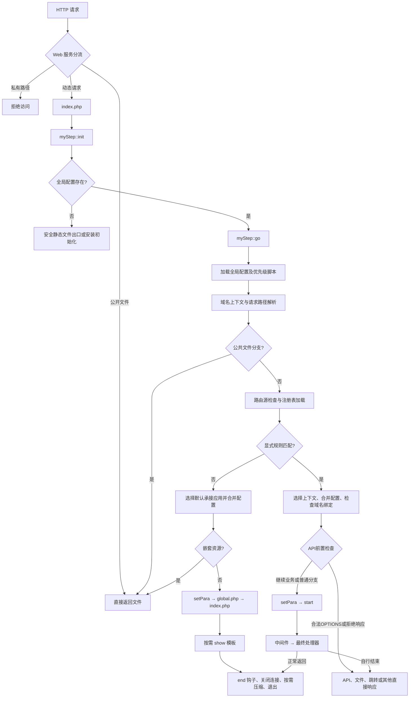

# 请求总流程与分支

修订日期：2026-10-23。适用于当前框架。

## 本篇目标与调用场景

按当前源码的条件与顺序说明本阶段；特别标明哪些分支会提前结束，哪些变量和钩子尚未可用。

## 1. 框架分层与主要职责

| 层次 | 核心位置 | 职责 |
| --- | --- | --- |
| HTTP 服务层 | Web 服务配置 | 将动态请求交给统一入口；直接处理允许公开的文件；保护代码及私有数据 |
| 统一入口 | `index.php` | 定义目录常量，载入框架，调用初始化方法 |
| 请求调度层 | `lib/myStep.class.php` | 初始化、配置合并、文件分流、应用上下文、认证启动、响应生命周期 |
| 路由层 | `lib/myRouter.class.php` | 解析请求路径、编译规则、按优先级匹配、执行中间件和处理器 |
| 控制器基础层 | `lib/myController.class.php` | 对象实例、别名、认证回调、资源收集、模块注册、钩子和基础响应 |
| 请求与认证层 | `lib/myReq.class.php`、`lib/myAuth.class.php` | 输入访问、Cookie、Session、密码验证、记住登录令牌 |
| 配置与基础服务层 | `myConfig`、`myCache`、`myDb` | 配置对象、缓存驱动、数据库连接与查询 |
| 输出层 | `myTemplate`、`myApi`、文件输出方法 | 页面渲染、API 结果转换、文件响应及输出压缩 |
| 框架内置入口 | `app/myStep/route.php` 等 | 后台入口规则和公共 API、模块、语言、设置、验证码、错误处理入口 |

框架并非每个请求都会建立完整页面上下文。静态资源、跳转、安装初始化、API 及部分模块具有不同的结束路径。


## 2. 总体执行流程



这个流程图表示调度关系。错误处理、关闭站点、权限中间件、页面缓存等均可能在相应阶段提前终止请求。


## 3. 入口阶段：index.php

统一入口按以下顺序执行：

1. 检查 PHP 最低版本。当前入口对低于 PHP 7.0 的版本直接终止。
2. 根据入口文件目录定义 `ROOT`，并统一目录分隔符。
3. 定义各功能目录常量。
4. 加载 `LIB.'myStep.class.php'`。
5. 调用 `myStep::init()`。

| 常量 | 表示的目录 |
| --- | --- |
| `ROOT` | 框架根目录 |
| `LIB` | 核心类库 |
| `APP` | 应用与框架内置入口 |
| `CACHE` | 运行缓存 |
| `CONFIG` | 全局配置及生成的索引 |
| `PLUGIN` | 扩展代码及注册信息 |
| `STATICS` | 公共静态资源 |
| `VENDOR` | Composer 依赖 |
| `FILE` | 上传或文件业务使用的目录 |

载入 `myStep.class.php` 时，同时加载公共函数、Composer 自动加载入口和控制器基类。框架自己的类加载器在随后的 `init()` 中注册。


## 11. 页面、模板、钩子与结束流程

### 11.1 render() 与 show()

| 方法 | 行为 |
| --- | --- |
| `render()` | 补充路径、语言和标签信息，返回渲染内容，供组合页面使用 |
| `show()` | 补充页面及路径变量，准备合并 CSS/JS，注入页面内容，渲染并实际输出 |
| `checkCache()` | 缓存命中后注入当前会话 CSRF 信息并输出，再立即调用 `end()` |

`show()` 的核心顺序为：框架补充公共模板变量 → 收集页面起止内容及资源标签 → 父类注入语言和自定义标签 → 模板渲染 → `page` 钩子处理渲染结果 → 输出 → 标记 `shown=true`。

模板编译缓存、页面 HTML 缓存、数据缓存、数据库查询缓存及合并脚本缓存是不同层次。仅调用 `show()` 不等于已经执行页面缓存命中检查；`checkCache()` 需要由相应页面流程调用。

### 11.2 通用扩展与钩子顺序

扩展登记、扩展初始化、钩子执行是三个不同步骤。活动注册信息在单次请求中读取后复用；功能忽略列表可跳过扩展初始化，但已登记的通用控制器钩子仍按代码调用点执行。

| 钩子 | 调用位置 | 默认执行顺序 |
| --- | --- | --- |
| `start` | 完整服务及认证启动之后 | 登记顺序 |
| `page` | 页面渲染之后、正文输出之前 | 登记顺序，页面参数（包括空串及 0）沿链传递 |
| `end` | 普通页面结束阶段 | 逆登记顺序 |

钩子处理器可以修改输出或自行结束请求。单个可调用数组 `[对象, 方法]` 与回调列表分别处理。`run()` 省略第三参数时向钩子传当前控制器；显式传第三参数时保持管道语义，即使值为 `""`、`"0"`、`0`、`false` 或 `null`，也不会中途改传控制器。数组按位置展开。

### 11.3 end() 与压缩

普通页面的 `myStep::end()` 顺序为：

1. 父类执行逆序 `end` 钩子。
2. 调用可选 `shutdown()`。
3. 存在延迟跳转目标且缓冲区无内容时，可直接跳转。
4. 准备编辑器相关扩展脚本缓存。
5. 关闭数据库并取得查询统计，计算耗时和内存峰值。
6. 清理数据库和缓存全局引用。
7. `shown=true` 时进入 `gzOut()`。
8. 退出当前请求。

`gzOut()` 根据 Accept-Encoding 及其质量参数、配置压缩级别、响应头是否发送、连接状态等决定压缩或原样输出，并设置对应的缓存协商响应头。不要将“请求结束”理解为“一定 gzip”。页面缓存直接输出、API、文件、跳转等路径也不一定进入这里。


## 12. URL 生成、错误与提前退出

### 12.1 setURL()

`setURL()` 生成框架链接，不执行路由匹配。它将路径与 `?query`、`#fragment` 分离，只规范化路径：

- `rewrite`：`ROOT_WEB + 路径`。
- `path_info`：`ROOT_WEB + index.php + 路径`。
- `query_string`：`ROOT_WEB + index.php? + 路径`，原查询参数改以 `&` 接续。

绝对 URI、协议相对地址及已包含入口文件的路径具有保持原样的兼容分支。路径重写不应修改查询参数中的 URL 或重复斜杠。

### 12.2 错误处理

错误处理分为初始化期处理器和完整运行期处理器。`myStep::header()` 为 403、404、500 设置真实 HTTP 状态；框架对象尚未创建时安全调用父类响应，不依赖语言包或模板对象。

对象已经创建时，部分错误通过框架信息提示页输出。提示页、返回值错误信息及 HTTP 状态是不同概念，处理器应明确自己使用哪一种协议约定。

### 12.3 文件与条件响应

`myController::file()` 打开本地文件，以流式 SHA-256 生成内容 ETag，再流式输出原始字节；不经过移除 BOM 的文本读取方法。默认输出缓冲在发送前清理，已有 `ob_gzhandler` 按分块缓冲恢复。HEAD 只发送头部；文件不存在返回 404。所有正常文件出口均立即结束请求，大文件不会落入后续路由或附加页面内容。

文件长度来自打开的文件；无压缩/自定义输出转换时设置 Content-Length。文件名过滤控制字符并通过 filename/filename* 编码。文件响应输出实际 Last-Modified；当前出口返回完整文件，不实现 Range 分段响应。

`etag()` 统一输出带引号标签，GET/HEAD 支持多个 If-None-Match、弱标签及星号，命中时输出无正文 304；POST 等方法不会误回 304。内容摘要可识别同秒同长度替换，代价是在发送前多读一次文件；公开静态资源优先由 Web 服务直接处理。

### 12.4 提前结束矩阵

| 请求或行为 | 是否通常完整启动服务 | 是否通常执行页面 end |
| --- | --- | --- |
| Web 服务直接返回文件 | 否 | 否 |
| 框架公共文件出口 | 否 | 否 |
| 默认入口嵌套 asset | 否，已加载入口配置 | 否 |
| 安装初始化 | 独立流程 | 不统一保证 |
| 路由命中后正常返回 | 是 | 是，除非处理器已经退出 |
| 默认入口普通页面 | 是 | 是，除非入口自行退出 |
| `getModule()` 页面模块 | 是 | 方法内调用 |
| 注册 API | 是 | 否，API 内退出 |
| `module()` 注册模块 | 是 | 不统一保证 |
| `redirect()` | 依调用位置而定 | 否 |
| `checkCache()` 命中 | 是 | 是，但不重新渲染页面 |
| 错误、验证码及下载 | 依入口而定 | 不统一保证 |


## 13. 请求状态与源码阅读索引

| 标识 | 生命周期及用途 |
| --- | --- |
| `$ms_setting` | 当前请求的配置对象，按阶段合并，控制器以引用使用 |
| `$router` | 当前请求路径、规则和 API 表 |
| `$info_app` | 最终或初步承接上下文；规则命中后会更新 |
| `$mystep` | 当前请求的框架实例或核心子类实例 |
| `$db`、`$cache` | 按需建立并复用的全局服务对象 |
| `$tpl_setting`、`$tpl_cache` | 页面模板初始化参数，不代表模板已渲染 |
| `ROOT_WEB` | 当前部署 Web 根路径 |
| `URL_FIX` | 可选的域名虚拟路径标识 |
| `PATH` | 完整运行上下文选定后定义的入口磁盘路径 |
| `myStep::$shown` | 是否已经通过框架 show 输出页面，影响结束压缩分支 |

推荐阅读顺序：

1. `index.php`：确认目录常量与唯一入口。
2. `lib/myStep.class.php` 的 `init()`、`go()`：理解前置分流及两条调度路径。
3. `lib/myRouter.class.php` 的 `init()`、`parseQuery()`、`parse()`：理解输入和上下文。
4. `refreshRoutes()`、`setRules()`、`rule()`：理解源与注册表。
5. `myRouter::check()`、`routeArguments()`：理解优先级与回调参数。
6. `myStep::setPara()`、`start()`、`setInstance()`：理解服务和认证顺序。
7. `myController::start()`、`run()`：理解扩展与钩子时机。
8. `myStep::api()`、`getModule()`、`module()`：区分不同分发协议。
9. `show()`、`render()`、`checkCache()`、`end()`、`gzOut()`：理解输出及结束条件。


## 操作步骤与注意事项

流程图是调度关系。API预检、文件、重定向、拒绝响应和缓存命中可以提前结束；优先脚本不具有常规会话上下文，end也不是全框架的finally。

## 主要方法：参数、返回和失败约定

### myStep::init

功能说明：框架变量初始化

参数说明：无显式参数。

Web请求在类加载注册后、缓存清理和应用/会话启动前检查已解析输入预算；
PHP解析器已可能处理请求，此检查不能替代运行时补丁及Web服务器限制。

```text
public static function init();
```

**返回**：void 设置核心路径、配置、自动加载及请求上下文；超预算请求返回400/413并结束

**异常**：InvalidArgumentException 受信的MYSTEP_REQUEST_LIMITS配置无效；RuntimeException 无法完整发布类索引

## 验证与进一步阅读

示例中的文件、数据库和变量按本篇前提准备；涉及写入时使用独占临时目录或隔离库，按明确返回值和异常验证。源码中的public/protected/private、引用参数和可选接口是实际契约，不能只按方法名猜测返回或能力。

[返回文档总览](../../README.md)
