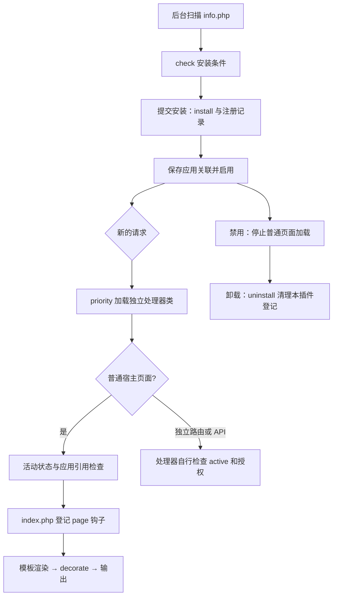

# 开发第一个 MyStepFW 插件

本教程创建一个名为 `hellonote` 的插件：给页面末尾加入可配置提示，并提供一个纯文本页面和只读状态 API。示例面向当前 PHP 8.5.12 框架，不建立业务表，不引入访问频率限制。

先完成 [第一个应用](../app/first-app.md)，得到 `Hello` 应用。本文默认只给该应用启用页面提示；插件独立路由的可见范围由路由和处理器控制，不自动受应用引用列表限制。

## 1. 先区分三个条件

| 条件 | 含义 |
| --- | --- |
| 已安装 | 插件管理器运行安装方法并写入注册库 |
| 已启用 | 注册库的 active 状态为 1 |
| 被当前应用引用 | 插件名出现在该应用的 plugin.php 数组中 |

普通页面中加载插件 `index.php`，需要插件有效、处于活动状态并被当前应用引用；功能忽略列表还可能跳过插件初始化。仅复制目录并不会自动加载插件。

路由发现和页面插件初始化不是同一套范围控制：活动插件可以提供全局路由，已知插件的显式映射也受活动状态约束；停用后不再编译对应路由/API，已复制的插件前置脚本也会跳过。本例仍在处理器检查 active 和业务授权，以保护直接调用。

## 2. 目录与命名

```text
plugin/hellonote/
├── info.php
├── class.php
├── index.php
├── config.php
├── priority.php
├── route.php
└── config/
    ├── construction.php
    ├── default.php
    └── chs.php
```

插件目录及 idx 为 `hellonote`，生命周期类名固定为 `plugin_hellonote`。插件标识须符合注册表idx列的长度限制；本例使用不超过10个ASCII字符的标识。结构和现状说明见 [插件目录说明](../../../plugin/README.md)。

`class.php` 不是继承 `myStep` 的第二个控制器，而是实现 `interface_plugin` 的插件类。运行期 `index.php` 被包含到控制器方法作用域中，里面的 `$this` 才是当前框架控制器。

## 3. 插件信息与运行配置

### plugin/hellonote/info.php

```php
<?php
return [
    'name' => '页面问候提示',
    'idx' => 'hellonote',
    'ver' => '1.0.0',
    'intro' => '展示插件配置、页面钩子与独立接口',
    'copyright' => '版权所有 2019-2026 <a href="mailto:windy2006@gmail.com">Windy2000</a>',
    'description' => '给 Hello 应用加入一条提示信息。',
    'app' => ['Hello'],
];
```

`app` 是后台安装/设置页的默认应用关联声明，不是接口访问权限白名单。不要在 `info.php` 中写入文件、建表或输出正文，后台扫描列表也会加载它。

### plugin/hellonote/config.php

```php
<?php
return [
    'message' => '这是我的第一个 MyStepFW 插件。',
];
```

运行配置由插件自己读取，不会自动合并到 `$ms_setting`。配置值仍需校验及输出转义。

## 4. 实现生命周期和业务方法

### plugin/hellonote/class.php

```php
<?php
class plugin_hellonote implements interface_plugin
{
    public static function check(&$result = '')
    {
        $ready = is_writable(CONFIG) && is_writable(CONFIG.'priority');
        $result = $ready ? '配置目录和 priority 目录可写。' : '请检查配置目录和 priority 目录权限。';
        return $ready;
    }

    public static function install()
    {
        if (!setPriority('hellonote')) throw new RuntimeException('Missing plugin priority script.');
        if (!regPluginRoute('hellonote')) throw new RuntimeException('Missing plugin routes.');
    }

    public static function uninstall()
    {
        removePluginRoute('hellonote');
        removePriority('hellonote');
        // 保留配置，避免卸载时误删用户填写的数据。
    }

    public static function active()
    {
        $plugins = myStep::activePlugins();
        return isset($plugins['hellonote']);
    }

    public static function message()
    {
        $config = include __DIR__.'/config.php';
        $message = $config['message'] ?? '';
        return is_string($message) ? mb_substr($message, 0, 200, 'UTF-8') : '';
    }

    public static function decorate($html)
    {
        if (!self::active()) {
            return $html;
        }
        $message = htmlspecialchars(self::message(), ENT_QUOTES, 'UTF-8');
        $note = '<aside class="hellonote" role="note">'.$message.'</aside>';
        $position = strripos($html, '</body>');
        return $position === false
            ? $html.$note
            : substr_replace($html, $note, $position, 0);
    }

    public static function page($path = '')
    {
        header('Content-Type: text/plain; charset=utf-8');
        if (!self::active()) {
            http_response_code(404);
            echo '插件未启用';
            return;
        }
        echo self::message();
    }

    public static function status(...$unused)
    {
        header('Content-Type: application/json; charset=utf-8');
        if (!self::active()) {
            http_response_code(404);
            return ['error' => 'Plugin is disabled'];
        }
        return ['ok' => true, 'plugin' => 'hellonote', 'message' => self::message()];
    }
}
```

`check()` 供后台展示安装前条件检查，成功返回 true，说明通过引用参数返回。安装前应存在可写的 `config/priority/` 目录；缺失时创建目录并赋予 PHP 所需权限。

`install()`、`uninstall()` 是显式管理动作，不在每个页面请求时执行。本例只登记和移除自己的路由、优先级文件，不删除全站缓存或其他插件数据。真正需要建表的插件应在安装/迁移中处理，并为重复执行设计明确行为。

`decorate()` 返回 HTML，而不是 echo；这样页面钩子链才能继续传递处理后的正文。纯文本页面不按 HTML 输出，API 返回的是数据，不在方法中手工拼 JSON。

## 5. 注册页面钩子

### plugin/hellonote/index.php

```php
<?php
require_once __DIR__.'/class.php';
$this->setFunction('page', 'plugin_hellonote::decorate');
```

插件按注册表 order 降序初始化，应用绑定只控制范围且重复项不重复加载；同值保持注册表原顺序。初始化时登记钩子，真正的插入发生在模板渲染完成之后。`page` 钩子可拿到整页 HTML，因此不需要修改宿主模板。

| 钩子或接口 | 常见用途 | 约定 |
| --- | --- | --- |
| `setFunction('start', ...)` | 请求初始化后准备数据 | 默认无额外参数时收到当前控制器；不要随意输出 |
| `setFunction('page', ...)` | 修改整页内容 | 接收正文并返回处理后的正文 |
| `setFunction('end', ...)` | 普通页面的收尾动作 | 按逆登记顺序执行；直接退出的 API 不保证运行 |
| `setAddedContent('start'/'end', ...)` | 注入资源或页面片段 | 宿主模板需有对应 page_start/page_end 占位符 |
| `regTag()` | 自定义模板标签 | 适合局部渲染；注意模板编译与动态值的关系 |
| `regModule()` | 注册模块文件或可调用方法 | 模块名使用插件前缀，避免覆盖其他扩展 |

一个插件通常不需要用完所有能力。本例只用 page 钩子，便于先理解插件生命周期。

## 6. 为独立页面和 API 准备类加载

### plugin/hellonote/priority.php

```php
<?php
require_once PLUGIN.'hellonote/class.php';
```

安装时 `setPriority()` 将这个文件复制到 `config/priority/plugin_hellonote.php`。插件处于活动状态时，请求前置阶段按注册表顺序加载它，使独立路由处理器在没有运行页面插件 `index.php` 时仍然可调用。标识含下划线时保持原样。

此处必须用 `PLUGIN` 定位源文件，不能用 `__DIR__.'/class.php'`：复制后 `__DIR__` 已经变为配置目录。这里只加载类定义，不输出内容、不执行页面钩子、不连接数据库。

禁用插件不会自动删除这个优先级文件，所以独立方法还需检查活动状态。卸载时本例主动移除它。

### plugin/hellonote/route.php

```php
<?php
$rule = [
    ['/hellonote/[any]', 'plugin_hellonote::page'],
];
$api = [
    'status' => 'plugin_hellonote::status',
];
```

路由源只声明规则，不应依赖它每次请求都加载类文件。源文件会编译为注册表，后续请求可能只加载编译结果。

`regPluginRoute()` 既更新编译表，也维护显式映射；`removePluginRoute()` 移除两处。使用这些框架辅助方法，不直接拼写编译表内容。

路由和优先脚本辅助方法的返回及异常约定：

| 方法 | 返回值及用途 |
| --- | --- |
| `regPluginRoute($idx)` | 同步成功返回 `true`；没有 `route.php` 返回 `false`，不登记失效路径。 |
| `removePluginRoute($idx)` | 清理完成返回 `true`，重复调用或插件目录已删除仍可清理。 |
| `setPriority($idx)` | 完整发布脚本返回 `true`；没有 `priority.php` 返回 `false`。 |
| `removePriority($idx)` | 删除成功或原文件不存在均返回 `true`，不递归删除意外同名目录。 |

路由操作需要框架已初始化全局 `$router`。源映射使用旁路锁合并，避免同时安装插件时覆盖彼此；菜单、源映射和优先脚本均先写临时文件再原子替换。非法标识、损坏的映射、加锁和写入失败会抛出异常。接口 `install()`/`uninstall()` 保留无返回值写法，管理器不检查它们的返回值；必需资源失败时应抛出异常。各文件原子发布不代表整个插件安装具备事务回滚。

后台插件页使用 `showPluginPage($idx, $page)`，先验证登录，再加载 `template/$page.tpl` 及可选的 `module/$page.php`；省略页名时使用插件目录名。模块可通过 `$tpl_sub` 赋值，或设置 `$content` 直接提供主体内容。

若需将插件内容嵌入当前应用，可调用：

```php
list($outer, $inner) = setPluginTemplate('hellonote', 'hellonote', false);
$inner->assign('message', 'Hello');
$outer->assign('main', $mystep->render($inner));
$mystep->show($outer);
```

第三个参数 `false` 复用应用的全局 `$tpl_setting`/`$tpl_cache` 创建外层模板，调用后不修改这两个全局变量；默认 `true` 使用框架后台 `main.tpl`。内容子模板始终关闭页面缓存，防止覆盖外层的整页缓存；外层启用缓存时仍需自行按身份、语言等设置隔离维度。

插件 API 分组会变为 `plugin_hellonote`，访问路径为 `/api/plugin_hellonote/status/json`。它不会自动继承应用的权限策略。示例的只读公开信息可以匿名查看；敏感 API 需要在自身方法中验证身份、权限和请求方法。

## 7. 让后台生成配置表单

以下三个文件为 `message` 提供可编辑表单。运行值仍存放在上一节的插件 `config.php`。

### plugin/hellonote/config/construction.php

```php
<?php
return ['text' => ['message']];
```

### plugin/hellonote/config/chs.php

```php
<?php
return [
    'name' => '问候提示设置',
    'list' => [
        'message' => [
            'name' => '提示文字',
            'describe' => '最多 200 个字符，按纯文本展示',
            'type' => ['text', '', '200'],
        ],
    ],
];
```

### plugin/hellonote/config/default.php

```php
<?php
return include __DIR__.'/chs.php';
```

`construction.php` 描述设置项类型，语言描述文件提供表单标签和控件参数。`default.php` 是描述回退入口，不是运行配置的初始值文件。站点使用其他语言时，应为该语言增加相应描述文件；需要时可暂时转引 `chs.php`。

表单长度只是第一道限制；`message()` 在运行时仍检查类型并截取长度，`decorate()` 仍执行 HTML 转义。不要把设置值直接当可执行 PHP 或未经处理的 HTML。

## 8. 安装与启用

1. 先确认 Hello 应用可访问。
2. 将以上文件保存到 `plugin/hellonote/`，用 PHP 8.5.12 对 PHP 文件做语法检查。
3. 使用管理员身份打开框架后台，进入插件管理。其逻辑地址是 `/{gen.path_admin}/function/plugin/`；如后台有独立域名，使用对应地址。
4. 在未安装列表找到“页面问候提示”，查看检查结果。
5. 保留 Hello 应用关联，填写提示文字并提交安装。
6. 确认插件出现在已安装列表且处于启用状态。
7. 确认 `app/Hello/plugin.php` 数组包含 `hellonote`。

应用关联文件可能已经包含其他插件，维护时合并数组，不要覆盖成只有本插件。后台通常会代为保存关联。

安装完成后，应看到注册库记录、应用关联、`config/priority/plugin_hellonote.php` 及显式路由映射。它们是框架生成的运行状态，不随插件源码一起手工伪造。

## 9. 验证结果

| 操作 | 预期 |
| --- | --- |
| 访问 `/Hello/` | 页面正文后出现问候提示 |
| 访问 `/Hello/hi/Alice` | 自定义路由页面也出现提示 |
| 访问 `/hellonote/` | 返回配置中的纯文本提示 |
| 访问 `/api/plugin_hellonote/status/json` | JSON 中 plugin 为 hellonote，ok 为 true |
| 在后台修改 message，再访问页面 | 显示新值 |
| 将 message 设为 `<script>alert(1)</script>` | 页面按文本显示，不执行脚本 |
| 后台禁用插件 | Hello 页面没有提示；路由/API停止登记，不再执行插件方法 |
| 仅从 Hello 关联中移除、仍保持活动 | Hello 页面没有提示；全局独立接口仍可调用 |
| 卸载插件 | 移除注册、应用关联、优先级及显式路由映射；配置源码保留 |

禁用或卸载后，原来的自定义URL可能交给站点默认入口，不保证统一返回404；没有登记的API沿现有协议返回Module is Missing，不能仅用HTTP 200判断业务成功。应检查该插件的方法不再执行，以及 API 不再返回插件成功数据。API可通过普通路径或已配置的专属域名验证；专属域名不强制重定向原路径，跨域与登录分别按当前接口和会话设置处理。

## 10. 生命周期速查



管理界面的检查结果不能替代 `install()` 内部必要的失败处理。后续如果安装过程涉及文件、数据表等多项修改，需要处理部分失败，避免记录显示已安装而资源只建立一半。

## 11. 可选能力与开发边界

语言包可以通过当前控制器的 `setLanguagePack()` 加载；插件语言键应带唯一前缀。静态样式和脚本可以通过 `addCSS()`、`addJS()` 收集，或通过明确允许的资源响应提供，不应公开整个插件目录。

后台管理页可以使用框架的 `showPluginPage()`，它会执行框架登录检查并组装主、子模板。使用前仍应区分插件配置页、只读接口及实际写入动作；状态修改应限定 POST，校验权限和 CSRF，不要把公开路由默认视为管理入口。

页面缓存可能让正文加工结果被缓存。本教程的 Hello 关闭页面缓存；以后启用时，需要为提示配置、用户差异和钩子执行频率设计缓存键及失效规则。不要在 page 钩子里执行付款、计费或不可重复操作。

`end` 钩子不是所有请求统一的 finally；API、文件输出和跳转可能提前退出。必须完成的资源释放与事务处理放在对应操作自己的 try/finally 或明确的异常处理路径中。

## 12. 常见问题

| 现象 | 检查方向 |
| --- | --- |
| 插件没有出现在未安装列表 | 目录、info.php、idx 是否一致，info 是否正确 return |
| 提示插件格式不正确 | 类名是否为 plugin_hellonote，是否实现 interface_plugin |
| 安装按钮不可用 | check 返回值，以及 config/priority 的存在和写权限 |
| 安装后页面没有提示 | active、Hello 的 plugin.php、功能忽略列表、是否经过 show |
| 插件路由回调不可调用 | priority 是否复制成功，是否错误使用复制后的 __DIR__，类名是否正确 |
| 禁用后独立接口还执行 | 注册表状态、框架版本与路由重建是否一致；处理器是否被直接调用并遗漏 active/授权检查 |
| 设置页无字段 | config.php、construction.php 及当前语言描述是否齐全 |
| 修改提示后旧值不变 | 页面缓存、模板/脚本缓存和浏览器缓存；不要直接删除全部缓存 |
| API 输出混入 HTML | priority/index/start 钩子是否输出了调试内容 |
| 页面钩子后内容消失 | decorate 是否返回原文或修改后的完整正文 |

框架接口依据：`plugin/interface_plugin.class.php`、`lib/myController.class.php`、`lib/myStep.class.php` 与 `app/myStep/module/function/plugin.php`。更多执行顺序见 [通用详细执行流程](../../backend/runtime/execution.md)。

## 13. 示例核验

本教程与应用教程共19个完整示例文件已从文档提取，使用PHP8.5.12完成语法及实际框架的隔离运行验证。插件场景覆盖配置表单生成、安装登记、宿主页钩子、独立页面和 API、HTML 转义、禁用拒绝及卸载清理；两篇合计18个运行场景通过。

验证在临时目录执行生命周期方法和框架请求调度，未在正式站点安装、启用或卸载插件；后台界面操作和浏览器展示需在开发环境按第 8、9 节验证。

## 写请求的框架保护

框架在会话启动后统一检查非安全 HTTP 方法的 CSRF 令牌。通过标准页面输出的 POST 表单和内置 Ajax 会自动携带；独立客户端先用同一 Cookie 会话访问 `/ms_csrf` 或框架 `csrf` API，再用 `X-CSRF-Token` 提交。跨应用时获取目标应用令牌。令牌不替代业务权限，所有状态修改应使用 POST。直接输出页面、外部回调及自定义 API 请按 [核心与调用入口完善记录](../../backend/security/security.md) 集成。
