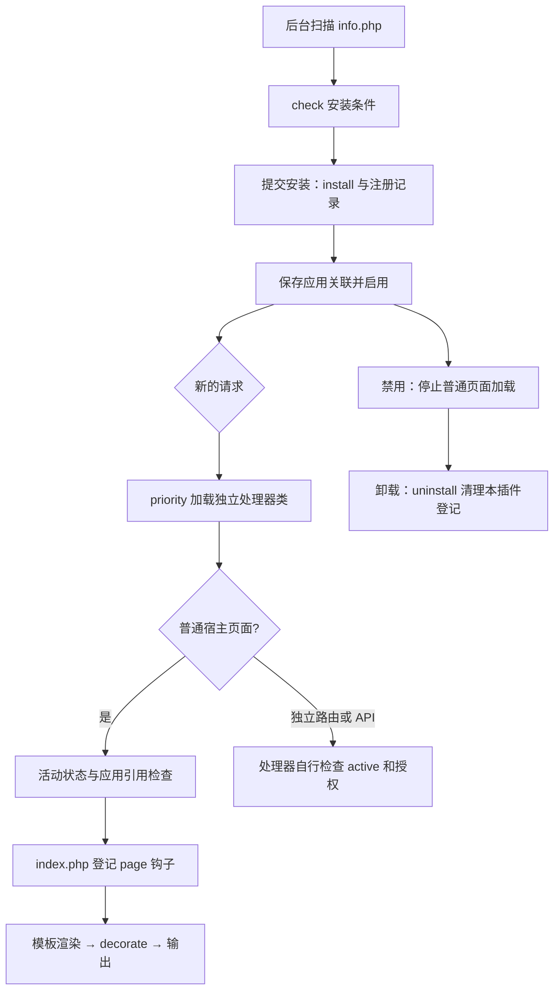

# 基础说明

## 本篇目标与调用场景

以hello为教学标识，区分生命周期、普通宿主初始化、独立路由/API与优先脚本。

## 1. 基础说明：插件何时生效

插件是可安装、启停并按应用绑定的扩展，不是必须实例化的新应用。普通宿主页面主要经过四层：后台安装登记、全局活动状态、当前应用 `plugin.php` 绑定，以及本次请求是否允许插件初始化。

插件路由／API 和优先脚本还有独立条件：不能因为没绑定某个页面应用就认为其全局路由不存在，也不能把“目录还在”当作已启用。新功能应清楚声明通过哪条链路生效。

插件使用当前宿主控制器的框架资源，普通 `index.php` 被包含时 `$this` 是宿主，不是插件对象。不要新建第二个 `myStep` 或另起 Session；插件专属辅助代码继续留在本插件目录。

## 操作步骤与注意事项

index.php中的$this是当前宿主控制器；class.php声明plugin_标识。设置、语言和资源均显式加载，独立入口不自动获得管理员权限。JS初始化代码放入前端脚本，后端负责数据和授权。

## 本环节的文件与调用实例

### 1. 先区分三个条件

| 条件 | 含义 |
| --- | --- |
| 已安装 | 插件管理器运行安装方法并写入注册库 |
| 已启用 | 注册库的 active 状态为 1 |
| 被当前应用引用 | 插件名出现在该应用的 plugin.php 数组中 |

普通页面中加载插件 `index.php`，需要插件有效、处于活动状态并被当前应用引用；功能忽略列表还可能跳过插件初始化。仅复制目录并不会自动加载插件。

路由发现和页面插件初始化不是同一套范围控制：活动插件可以提供全局路由，已知插件的显式映射也受活动状态约束；停用后不再编译对应路由/API，已复制的插件前置脚本也会跳过。本例仍在处理器检查 active 和业务授权，以保护直接调用。

### 10. 生命周期速查

管理界面的检查结果不能替代 `install()` 内部必要的失败处理。后续如果安装过程涉及文件、数据表等多项修改，需要处理部分失败，避免记录显示已安装而资源只建立一半。

## 验证与进一步阅读

示例中的文件、数据库和变量按本篇前提准备；涉及写入时使用独占临时目录或隔离库，按明确返回值和异常验证。源码中的public/protected/private、引用参数和可选接口是实际契约，不能只按方法名猜测返回或能力。

[返回文档总览](../../README.md)
