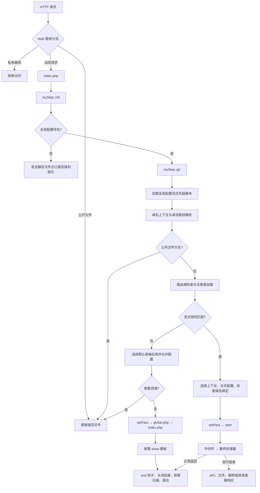

# 框架执行流程与路由调度

整理日期：2026-10-18。目标运行环境：PHP 7.4。本文合并通用详细流程与核心执行检查；修复表和性能测量属于原检查记录，不能代替本次测试。

本文以当前框架核心代码为依据，说明 HTTP 请求从入口到响应结束的通用执行过程，可用于理解源码、开发扩展及排查路由问题。文中不包含具体业务应用、具体插件的配置，也不包含站点域名、数据库凭据、主机目录或本机服务设置。

`app/myStep/` 是框架自带的管理与公共能力承载目录，属于本文范围；`app/{app}/`、`{core}` 等表示框架允许接入的抽象扩展。插件只作为框架扩展机制说明，不涉及任何具体插件的启用状态或参数。

本文描述当前 PHP 7 系列兼容实现，代码核对日期为 2026-10-17。本轮在 PHP 7.4 下验证。代码中的分支及提前退出行为优先于下文的概括流程。

核心修复、兼容边界及验证入口已并入本文末尾。

## 1. 框架分层与主要职责

| 层次 | 核心位置 | 职责 |
| --- | --- | --- |
| HTTP 服务层 | Web 服务配置 | 将动态请求交给统一入口；直接处理允许公开的文件；保护代码及私有数据 |
| 统一入口 | `index.php` | 定义目录常量，载入框架，调用初始化方法 |
| 请求调度层 | `lib/myStep.class.php` | 初始化、配置合并、文件分流、应用上下文、认证启动、响应生命周期 |
| 路由层 | `lib/myRouter.class.php` | 解析请求路径、编译规则、按优先级匹配、执行中间件和处理器 |
| 控制器基础层 | `lib/myController.class.php` | 对象实例、别名、认证回调、资源收集、模块注册、钩子和基础响应 |
| 请求与认证层 | `lib/myReq.class.php`、`lib/myAuth.class.php` | 输入访问、Cookie、Session、密码验证、记住登录令牌 |
| 配置与基础服务层 | `myConfig`、`myCache`、`myDb` | 配置对象、缓存驱动、数据库连接与查询 |
| 输出层 | `myTemplate`、`myApi`、文件输出方法 | 页面渲染、API 结果转换、文件响应及输出压缩 |
| 框架内置入口 | `app/myStep/route.php` 等 | 后台入口规则和公共 API、模块、语言、设置、验证码、错误处理入口 |

框架并非每个请求都会建立完整页面上下文。静态资源、跳转、安装初始化、API 及部分模块具有不同的结束路径。

## 2. 总体执行流程



这个流程图表示调度关系。错误处理、关闭站点、权限中间件、页面缓存等均可能在相应阶段提前终止请求。

## 3. 入口阶段：index.php

统一入口按以下顺序执行：

1. 检查 PHP 最低版本。当前入口对低于 PHP 7.0 的版本直接终止。
2. 根据入口文件目录定义 `ROOT`，并统一目录分隔符。
3. 定义各功能目录常量。
4. 加载 `LIB.'myStep.class.php'`。
5. 调用 `myStep::init()`。

| 常量 | 表示的目录 |
| --- | --- |
| `ROOT` | 框架根目录 |
| `LIB` | 核心类库 |
| `APP` | 应用与框架内置入口 |
| `CACHE` | 运行缓存 |
| `CONFIG` | 全局配置及生成的索引 |
| `PLUGIN` | 扩展代码及注册信息 |
| `STATICS` | 公共静态资源 |
| `VENDOR` | Composer 依赖 |
| `FILE` | 上传或文件业务使用的目录 |

载入 `myStep.class.php` 时，同时加载公共函数、Composer 自动加载入口和控制器基类。框架自己的类加载器在随后的 `init()` 中注册。

## 4. 基础初始化：myStep::init()

### 4.1 输出缓冲与类加载

初始化先调整输出缓冲，再读取 `config/class.php` 中的类加载路径和索引。

- 索引有效：直接向框架类加载器注册。
- 索引缺失、为空、结构/语法损坏，或首项根路径与当前 `LIB` 不一致：建立核心类库和数据库驱动搜索路径，原子重写类索引，注册加载器，并清理路由编译文件及模板编译目录。旧目录仍存在的迁移也会触发修复，不会继续加载旧根目录代码。

注册类加载器后，Web请求先执行 `mySecurity::guardRequest()` 检查已解析输入及声明体积，再进行上述路由/模板缓存清理；拒绝时以400/413固定JSON结束，不启动应用或会话。CLI/phpdbg跳过。PHP本身可能已解析请求，不能把此检查当作运行时漏洞修复；类索引的必要加载和重建仍早于该检查。额度、覆盖方法及解析前部署要求见 [PHP运行时加固](php-runtime-hardening.md)。

这类修复针对可重建的索引与编译产物，不删除现有 Session 数据。

之后计算 `ROOT_WEB`。它代表站点入口对应的 Web 路径，例如 `/` 或 `/sub/`，与磁盘路径 `ROOT` 不是同一种值。

### 4.2 初始错误处理

此时尚未选定请求承接对象，也未启动登录和数据库服务。框架先注册基础异常处理，将日志目标设为根目录的 `error.log`。进入完整 `start()` 后，会依据运行配置重新设置错误级别与回调行为。

### 4.3 安装分支与正常分支

| 条件 | 下一步 |
| --- | --- |
| 存在 `config/config.php` | 调用 `myStep::go()` |
| 缺少全局配置 | 对允许的静态文件安全输出，否则进入框架自带安装初始化入口 |

安装分支仍会检查静态目录边界和真实文件扩展名，不因为配置尚未生成而放开任意文件读取。

## 5. 请求准备：myStep::go()

### 5.1 全局配置与特殊地址

`go()` 创建全局 `$ms_setting` 配置对象。精确匹配到旧式 feed 地址时，可先返回规范化跳转：`sitemap.xml`、`atom.xml`、`rss.xml` 或其带末尾斜杠形式转为对应无扩展名入口，并保留查询串。

随后扫描 `config/priority/` 中符合入口信息文件检查的脚本，先执行应用前置逻辑，再按注册表 order 降序执行活动插件的前置逻辑，再设置内存限制与调试相关的 OPcache 重验证选项。调试流程不主动重置整个 OPcache。服务器显式设置环境变量 `MYSTEP_PRESERVE_MEMORY_LIMIT=1` 时，保留启动期内存策略，不再写入 `gen.memory`；该开关自身不设置或取消内存上限，详见 [PHP运行时加固](php-runtime-hardening.md)。

### 5.2 域名上下文

框架规范化请求 Host 后读取可选的 `config/domain.php`：

- 绑定值为应用标识时，形成对应的虚拟路径前缀。
- 绑定值为路由模式时，从模式中取得首个单词路径段，作为虚拟前缀。
- 未命中绑定时，不添加域名前缀。

这里可能定义 `URL_FIX`，并设置路由的 `url_fix`。域名绑定改变请求的解释上下文，并不等于立即跳转；真正的强制域名跳转由后续 `checkBind()` 判断。

### 5.3 创建路由对象

使用全局 `router` 配置创建 `$router`。对象初始化即解析请求，得到标准化的路径、查询串、初步承接应用和剩余路径段；此时尚未执行路由处理器。

### 5.4 文件响应与缺失资源

在完整路由初始化之前，框架检查可以直接返回的公共文件：

1. `static/` 前缀相对于静态根目录解析。
2. 其他公共文件相对于 `ROOT` 解析。
3. 解码请求路径，拒绝隐藏路径段及私有目录。
4. 对 `realpath` 结果再次检查目录边界和私有区域。
5. 校验允许的扩展名；公共文件出口同时核对请求名称及真实目标，防止符号链接将公开扩展名指向源码。
6. 满足条件时调用文件响应方法并退出。

`myFile::resolveWithin()` 只接受指定目录内已存在的普通文件，拒绝空字节、反斜杠、隐藏或穿越路径段以及逃离根目录的链接。公开目录及扩展名仍由调用方进一步限制。

框架保护配置、核心库、测试、维护脚本、非公共缓存及上传日志等区域。文件目录常量只表示用途，不代表该目录下的全部内容都可以公开读取。

部分缺失资源按现有逻辑返回占位图片、空 CSS/JS/JSON 等内容后退出；私有路径及安全检查失败则拒绝访问。排查资源问题时，应区别“安全拒绝”“实际文件响应”和“缺失资源占位响应”。

### 5.5 请求共享信息与别名

进入动态分支后，补齐 Cookie 作用域、当前站点 URL，读取可选的全局变量别名映射。随后执行路由刷新和规则加载，并设置请求的初步 `$info_app` 及日志忽略标志。

## 6. 路由解析、规则加载与缓存

### 6.1 三种 URL 输入

以下示例仅说明路由形态，`path/to/resource` 不对应任何预设业务模块：

| 模式 | URL 示例 |
| --- | --- |
| `rewrite` | `/path/to/resource?x=1` |
| `path_info` | `/index.php/path/to/resource?x=1` |
| `query_string` | `/index.php?/path/to/resource&x=1` |

`parseQuery()` 在服务变量之间按当前实现提取路径：优先使用 PATH_INFO，再兼容 ORIG_PATH_INFO，否则从 REQUEST_URI 中去除入口文件或部署子目录。识别到明确的旧式查询路径时，该路径覆盖前面的路径结果；重定向标记也有独立兼容分支。

随后将查询串与路径分离。路径统一以 `/` 开始，纯单词及斜杠构成的路径保留历史末尾斜杠约定；查询参数按配置分隔符处理后通过 `parse_str()` 解析，同时更新 `$_GET` 和 `$_SERVER['QUERY_STRING']`。

注意：`parse_str()` 具有 PHP 自身的解码、数组参数及重复键语义；框架不会保存一套独立于 PHP 的原始多值参数模型。路径中的百分号编码也不在此阶段统一解码，文件安全检查会自行解码。

| 路由字段 | 含义 |
| --- | --- |
| `route['p']` | 匹配使用的路径 |
| `route['q']` | 分离后的查询串 |
| `route['qstr']` | 兼容性组合值，路径和参数以 `&` 连接 |
| `query` | 当前参与匹配的路径，不包含查询串 |
| `info['app']` | 初步承接应用标识 |
| `info['path']` | 去除应用标识后的路径段 |
| `info['para']` | 已解析的查询参数 |

`parse()` 仅在首段是合法单词标识且存在对应 `info.php` 时将其识别为应用；否则使用 `router.default_app`，原路径由该默认入口承接。

### 6.2 路由源与编译注册表

框架扫描具有有效 `info.php` 的应用目录，加载各自 `route.php` 中的三类定义：

| 源变量 | 生成变量 | 内容 |
| --- | --- | --- |
| `$format` | `$format_list` | 命名路径格式 |
| `$rule` | `$rule_list` | 路由模式与处理器 |
| `$api` | `$api_list` | API 名称与处理器 |

扩展路由还可以由活动扩展注册信息或显式路由映射提供。这里描述的是框架的通用发现机制，不要求安装或启用任何具体扩展。

`refreshRoutes()` 维护以下运行文件：

- `config/route.php`：编译后的格式、规则和 API 表。
- `config/route.php.sources.json`：源指纹与注册表校验信息。
- `config/route.php.lock`：串行化写操作的独立锁文件。

检查内容覆盖全局配置、显式扩展映射、扩展注册库、有效应用的路由/配置/扩展清单以及发现的扩展路由文件。显式扩展映射中位于默认插件目录之外的源文件也参与检查；源文件从缺失变为存在同样触发重建。使用内容哈希而非仅看修改时间，因此同一时间戳内的等长修改也能触发重建。

源及注册表均未变化时，跳过源文件包含和重建。发生变化时：

1. 获取排他锁，再次确认是否需要重建。
2. 只加载一次磁盘基础配置，再为每个应用克隆独立副本并合并其配置，避免重复读取及跨应用污染。
3. 定向失效变更路由源的 OPcache，收集格式、规则和 API；正常或异常结束均恢复请求原始配置对象。
4. 合并通用扩展路由来源。
5. 将框架 `myStep` 通用规则分组放到最后。
6. 写入临时文件并原子替换注册表，定向失效其 OPcache。
7. 原子更新元数据，最后释放锁。

应修改路由源，不应把生成的 `config/route.php` 当作长期维护入口。`checkRoute()` 和 `remove()` 也使用同一注册表锁；直接修改编译结果会在后续源校验中被恢复。

### 6.3 规则载入与编译

`setRules()` 加载注册表时同时取得 API 表。自定义格式按应用分组隔离，不跨组污染；异常退出也恢复格式上下文。每条规则在注册时构造并验证完整正则表达式。

| 占位符 | 默认表达式 | 含义 |
| --- | --- | --- |
| `[int]` | `(\d+)` | 数字序列 |
| `[str]` | `(\w+)` | 单词字符序列 |
| `[any]` | `(.*)` | 可包含路径分隔符的剩余文本 |
| `[name]` | 已注册的命名格式 | 通过 `format()` 定义的匹配模式 |

规则使用正则语义，并以路径完整匹配及可选末尾斜杠包装。字面量中的正则特殊字符需要显式转义。未注册的占位名按当前兼容行为成为该名称的字面匹配捕获，并不是任意字符串匹配。

自定义格式中的普通捕获括号转换为非捕获括号，再保留外层参数捕获；复杂命名捕获与反向引用仍需按实际正则语义核对。持久化源应使用命名回调；真实 Closure 可在内存中注册，不能直接保存到生成注册表。

## 7. 路由匹配、上下文选择与处理器执行

### 7.1 匹配优先级

`myRouter::check()` 分两轮扫描规则：

1. 使用原始标准路径匹配所有规则，取首条命中。
2. 第一轮没有命中且存在有效域名前缀时，将前缀加到路径前再扫描，仍取首条命中。
3. 都没有命中时返回 `false`，交给 `go()` 的默认入口分支。

因此，第一轮的通用规则也优先于第二轮的扩展规则；不是逐条交替尝试“原路径、带前缀路径”。同一轮中的次序由注册表和规则声明顺序决定，不按路径长短自动排序。

前缀判断使用路径段边界，避免一个标识错误覆盖另一个以相同字符开头的标识。即使路径首段存在有效应用目录，也不会跳过显式路由检查。

### 7.2 命中后的配置与核心选择

命中规则后，框架取得正则捕获值，并依据规则所属分组、API 或模块特殊规则确定承接入口。随后：

1. 读取入口信息，更新全局 `$info_app` 的 `path`、`para` 和 `route`。
2. 合并对应应用 `config.php`，以及存在时按命中首段选择的 `config_{segment}.php`。
3. 必要时合并指定核心的配置。
4. 执行 `checkBind()`。
5. 执行 `setPara()`，建立完整请求运行环境。
6. 运行中间件及最终处理器。

`getCore()` 从请求 `core` 或域名绑定推导核心标识，只接受单词标识、目录范围内存在的类文件，以及继承 `myStep` 的类；无效输入回退到基础框架。共享框架 API 在选用有效的其他核心时，会在初始化及认证前切换承接上下文，而不只是事后覆盖配置值。

`/module/` 的域名前缀只有在存在相应 `info.php` 时才作为应用选择；`console`、`api` 一类路由前缀不自动当作应用目录。

配置存在多个合并阶段，不应把执行顺序理解成“所有配置启动时一次加载”。API 分发内部还可能合并目标 API 所属入口配置。

### 7.3 处理器与参数约定

单处理器可以是命名函数、静态方法、可调用数组或 Closure。字符串形式支持 `handler,arg1,$1`：

- 固定参数从字符串中按逗号拆分并去除两侧空白。
- 完整的 `$1`、`$2` 等引用对应捕获值，并去除其两端斜杠。
- 单处理器在显式参数之后，还接收所有原始捕获值；其中可能保留历史尾斜杠。

所以，`$1` 替换不是“替换后不再传原始捕获值”。编写回调签名时应核对实际参数数量。

方法数组若自身可调用，按单个处理器执行；否则视为流水线，最后一项是最终处理器，其余项是中间件：

| 环节 | 接收参数 |
| --- | --- |
| 第一项中间件 | 自身显式参数，随后是初始值 `true` |
| 后续中间件 | 自身显式参数，随后是上一项返回值 |
| 最终处理器 | 自身显式参数、所有捕获值按路径分隔符拼接的字符串、中间件返回值数组 |

任一中间件返回严格 `false` 时，不再调用最终处理器；该中间件负责正文和状态。`check()` 仍返回已命中，外层不会再执行默认入口，并在没有其他提前退出时继续到结束流程。

## 8. 域名检查与默认入口分支

### 8.1 checkBind()

域名强制绑定关闭或当前为文件上传请求时，`checkBind()` 直接返回。其余情况下，只有绑定表存在与当前规则/应用完全对应的值，且当前 Host 不属于已绑定域名，才转到第一个对应域名。

跳转会去除已消费的路径前缀并保留查询串。GET/HEAD 使用 302，其他方法使用 307，以保留请求方法和请求体。`redirect()` 生成最终地址、关闭已创建数据库连接、清理相关全局引用后发送 Location 并退出。

### 8.2 没有显式规则命中

`go()` 使用路由对象初步解析的入口信息：

1. 检查承接应用是否存在。
2. 合并其配置并执行域名检查。
3. 若剩余路径以 `asset/` 开始，按当前模板样式目录、公共 asset 目录、默认样式目录查找完整嵌套资源。
4. 资源命中且安全检查通过时直接输出；未找到时进入缺失资源处理。
5. 普通请求补齐内部 route 的虚拟前缀，再执行 `setPara()`。
6. 将首个剩余路径段提供为 `$m`，载入可选 `global.php`，执行入口 `index.php`。
7. 如果入口准备了 `$tpl`，将可选 `$content` 赋给 `main` 后调用 `show()`。
8. 返回公共结束流程。

默认入口如何解释剩余路径，属于接入者实现。框架不会自动把每个 URL 都映射为同名 PHP 文件。

## 9. 完整运行上下文：setPara() 与 start()

### 9.1 setPara()：对象及输出准备

`setPara()` 首先检查全局 `$mystep` 是否已经建立；存在则直接返回，避免重复初始化。首次调用按以下顺序执行：

1. 根据实际命中的应用与路径决定 `no_log`，然后执行 `checkClose()`：框架内置管理入口豁免，其余入口按关闭与调试配置处理。
2. 定义 `PATH = APP.{当前入口}/`。
3. 载入可选同名核心类；只有有效 `myStep` 子类才被选为请求对象，否则使用 `myStep`。
4. 创建 `$mystep`。构造时绑定全局配置，设置时区和运行超时。
5. 载入当前入口 `lib.php`，调用可选 `preload()`。
6. 收集全局及入口 CSS/JS，确定合并脚本缓存位置，加入前端设置/语言的加载代码。
7. 建立 `$tpl_setting` 和 `$tpl_cache`。调试模式或关闭页面缓存时，页面缓存参数设为 `false`。
8. 调用对象的 `start()`。

只有实际归属 `myStep` 的公共框架端点才可通过 `no_log` 跳过会话，验证码仍启动会话。该判断放在路由匹配之后，不以初步解析得到的模块名称决定：例如 `/Admin/error` 属于 Admin 的受保护日志页，不能因为模块名为 `error` 而跳过会话。规则匹配前后路径中是否包含应用前缀的差别会先统一处理。

`preload()` 早于默认 Session 启动和登录恢复；其中不应假定这些阶段已经完成。

### 9.2 start()：服务、认证与钩子

| 顺序 | 执行动作 | 结果 |
| --- | --- | --- |
| 1 | 记录时间、内存，载入类别名，调整错误处理 | 请求运行诊断就绪 |
| 2 | 依据当前入口清单与活动注册表，按 order 降序去重登记扩展 | 只登记符合条件的扩展，不代表其初始化已执行 |
| 3 | 未提供认证回调时安装默认 login/logout/chg_psw | 允许接入者预先注册替代回调 |
| 4 | `setInstance()` | 缓存和数据库对象可用，已存在时复用 |
| 5 | 设置 Cookie 前缀、会话位置、请求时间和 Host 信息 | 请求上下文补齐 |
| 6 | 先加载框架语言包，再加载当前入口语言包 | 同名语言项可由后者覆盖 |
| 7 | `myReq::init()`、选择 Session 驱动、`sessionStart()` | Cookie/Session 访问环境就绪 |
| 8 | `mySecurity::guard()`，然后 `$this->login()` | 检查会话 CSRF 令牌及操作方法，再恢复当前身份 |
| 9 | 合并功能忽略列表，准备页面 start/end 内容容器 | 决定是否执行扩展初始化 |
| 10 | 计算 `url_prefix` | 在扩展和启动钩子使用链接前缀前准备就绪 |
| 11 | 父类 `start()` | 字符集、基础响应头、输出缓冲及 OPcache 选项 |
| 12 | 需要时初始化扩展，再运行 `start` 钩子 | 扩展启动发生在登录恢复之后 |

父类基础响应使用 HTML 内容类型；API 或文件处理器可按自己的逻辑设置响应头，不能据此认为所有出口都默认发送 JSON。

### 9.3 缓存与数据库实例

`setInstance()` 根据配置选取缓存驱动。数据库缓存模式使用连接配置，其他默认路径使用数据缓存目录。创建 `myDb` 后，仅在 `db.auto` 开启时自动连接、选择库并挂接查询缓存；关闭自动连接时切换为文件会话模式。

`myController::getInstance()` 对新实例优先执行真实构造器，没有构造器时按可调用 `init()` 初始化；无参且缺少必需参数时保留延迟初始化约定。已有单例无参取得时不重复初始化，显式传参仍可重新初始化。初始化失败不发布新单例。`myStep::getInstance()` 额外加载可调用的 `regAlias()`，并只对框架基类实例设置错误回调。

对象存在不等于数据库连接已经建立。静态分支也不必创建数据库对象。`preload()` 或其他前置逻辑已经创建的全局对象会被复用。

### 9.4 框架默认身份恢复

默认登录回调为 `ms_login()`：显式凭据通过用户名和密码验证后建立认证会话；没有显式凭据时，核对会话身份与密码版本，或验证有效的记住登录令牌。成功时记录框架管理员身份和权限标志，必要时轮换会话 ID。

密码验证、升级及令牌验证由 `myAuth` 承担。记住登录令牌有到期时间和用途范围，不把密码或密码摘要直接作为 Cookie 身份证明。默认退出清除相关认证 Cookie 并结束会话；修改密码会更新密码版本并使旧令牌失效。

`myStep::checkPower()` 可以委派给核心子类；子类仅继承该方法或显式调用 `parent::checkPower()` 时执行框架默认检查，避免委派回自身形成无限递归。

初始化时的身份恢复不是对所有处理器自动授权。受保护的入口仍需通过登录/权限中间件或处理器自己的校验决定是否允许操作。

## 10. 框架内置路由及专用分支

规则源位于 `app/myStep/route.php`。此处只列框架自带规则，不列其他入口的配置。

| 模式 | 处理器 | 作用 |
| --- | --- | --- |
| `/api/[str]/[any]` | `myStep::api` | 注册 API 分发 |
| `/module/[str]/[any]` | `myStep::module` | 注册模块分发 |
| `/sitemap`、`/atom`、`/rss` | `myStep::appFunc` | 调用当前核心提供的对应功能文件 |
| `/ms_language/[str]/[any]` | `myStep::language` | 生成前端语言脚本 |
| `/ms_setting/[any]` | `myStep::setting` | 生成前端设置脚本 |
| `/captcha/[any]` | `myStep::captcha` | 验证码输出 |
| `/error/[int]` | `myStep::header` | 指定状态的错误响应 |
| `/{gen.path_admin}/[any]` | 框架登录检查 → `myStep::getModule` | 框架管理入口，名称来自配置 |

### 10.1 API 分支

`myStep::api()` 在完整初始化之后执行，流程为：

1. 设置跨域相关响应头和 `Vary: Origin`。
2. 若请求携带 Origin，校验同源、已绑定域名/根域名或显式允许来源。默认信任范围还检查协议与端口；不允许的来源返回 403 并退出。
3. OPTIONS 返回 204，不执行业务 API。
4. 从路由对象复用已加载的 API 表，解析目标分组、方法、剩余参数和输出类型。
5. 根据 API 表定位目标方法，按分支合并目标配置并载入公共函数。
6. GET/HEAD 使用 GET 参数；其他方法合并 GET 与 POST，同名项以 POST 为准，移除已消费的框架控制参数 `core`，再与路径参数组合交给 `myApi`。
7. `myApi::run()` 调用注册方法并转换为 JSON、XML、字符串、十六进制或脚本等格式。
8. 处理缓冲区内容并输出结果，直接 `exit`。

注册方法最终仍按遍历顺序接收位置参数。POST 不再因为 URL 同时带查询串而丢弃表单数据，`core` 也不再占据第一个业务参数；路径参数及历史输出类型处理约定保留。API 若自行输出缓冲内容，也可能覆盖原本的转换结果。实现新接口时应显式约定参数和响应头。

框架内置 API 包含错误上报、数据及自动完成工具、分词、上传、下载和删除文件入口。上传与删除文件只接受 POST，其他 HTTP 方法返回 405 及 `Allow: POST`。是否授权具体操作仍取决于相应处理器校验；非安全方法另由会话 CSRF 保护；已识别后台状态修改仅接受 POST。CORS、CSRF 都不能替代业务权限。通过 `/ms_csrf` 或框架 `csrf` API 可获取目标应用会话令牌，详见 [后续完善记录](security-attachments.md)。

API 自行退出，通常不运行普通页面的 `show()` 和 `end()` 钩子。

### 10.2 getModule()：页面模块查找

`getModule()` 是页面处理器，不等同于 `/module/` 的注册模块分发。它先创建模板并载入可选 `global.php`，再按以下顺序查找文件；`{idx}` 为传入模块路径的首段，`{first}` 为上下文首段：

```text
PATH/module/{style}/{idx}.php
PATH/module/{style}/{first}.php
PATH/module/{style}/index.php
PATH/module/{idx}.php
PATH/module/{first}.php
PATH/module/index.php
```

首个存在的文件被包含；都不存在则触发模块缺失提示。若模块产生 `$content`，赋给模板 `main` 并调用 `show()`，最后调用 `end()` 结束请求。

### 10.3 module()：已注册模块分发

`module()` 根据路径构造已注册模块名称，从框架模块表查找文件或回调。文件模块准备了模板时，可补载上下文文件并输出页面；回调模块直接调用。成功分发后直接退出，缺失时跳转，不保证执行完整页面 `end()`。

### 10.4 appFunc() 与其他直接响应

`appFunc()` 根据有效核心标识查找指定功能文件，找不到时跳转。它是框架提供的功能文件分发机制，具体 feed 内容不属于框架通用流程。

语言、设置、验证码、下载和错误等入口也可能自行输出及结束。不能依赖页面末尾钩子统一处理这类响应的业务副作用。

## 11. 页面、模板、钩子与结束流程

### 11.1 render() 与 show()

| 方法 | 行为 |
| --- | --- |
| `render()` | 补充路径、语言和标签信息，返回渲染内容，供组合页面使用 |
| `show()` | 补充页面及路径变量，准备合并 CSS/JS，注入页面内容，渲染并实际输出 |
| `checkCache()` | 缓存命中后注入当前会话 CSRF 信息并输出，再立即调用 `end()` |

`show()` 的核心顺序为：框架补充公共模板变量 → 收集页面起止内容及资源标签 → 父类注入语言和自定义标签 → 模板渲染 → `page` 钩子处理渲染结果 → 输出 → 标记 `shown=true`。

模板编译缓存、页面 HTML 缓存、数据缓存、数据库查询缓存及合并脚本缓存是不同层次。仅调用 `show()` 不等于已经执行页面缓存命中检查；`checkCache()` 需要由相应页面流程调用。

### 11.2 通用扩展与钩子顺序

扩展登记、扩展初始化、钩子执行是三个不同步骤。活动注册信息在单次请求中读取后复用；功能忽略列表可跳过扩展初始化，但已登记的通用控制器钩子仍按代码调用点执行。

| 钩子 | 调用位置 | 默认执行顺序 |
| --- | --- | --- |
| `start` | 完整服务及认证启动之后 | 登记顺序 |
| `page` | 页面渲染之后、正文输出之前 | 登记顺序，页面参数（包括空串及 0）沿链传递 |
| `end` | 普通页面结束阶段 | 逆登记顺序 |

钩子处理器可以修改输出或自行结束请求。单个可调用数组 `[对象, 方法]` 与回调列表分别处理。`run()` 省略第三参数时向钩子传当前控制器；显式传第三参数时保持管道语义，即使值为 `""`、`"0"`、`0`、`false` 或 `null`，也不会中途改传控制器。数组按位置展开。

### 11.3 end() 与压缩

普通页面的 `myStep::end()` 顺序为：

1. 父类执行逆序 `end` 钩子。
2. 调用可选 `shutdown()`。
3. 存在延迟跳转目标且缓冲区无内容时，可直接跳转。
4. 准备编辑器相关扩展脚本缓存。
5. 关闭数据库并取得查询统计，计算耗时和内存峰值。
6. 清理数据库和缓存全局引用。
7. `shown=true` 时进入 `gzOut()`。
8. 退出当前请求。

`gzOut()` 根据 Accept-Encoding 及其质量参数、配置压缩级别、响应头是否发送、连接状态等决定压缩或原样输出，并设置对应的缓存协商响应头。不要将“请求结束”理解为“一定 gzip”。页面缓存直接输出、API、文件、跳转等路径也不一定进入这里。

## 12. URL 生成、错误与提前退出

### 12.1 setURL()

`setURL()` 生成框架链接，不执行路由匹配。它将路径与 `?query`、`#fragment` 分离，只规范化路径：

- `rewrite`：`ROOT_WEB + 路径`。
- `path_info`：`ROOT_WEB + index.php + 路径`。
- `query_string`：`ROOT_WEB + index.php? + 路径`，原查询参数改以 `&` 接续。

绝对 URI、协议相对地址及已包含入口文件的路径具有保持原样的兼容分支。路径重写不应修改查询参数中的 URL 或重复斜杠。

### 12.2 错误处理

错误处理分为初始化期处理器和完整运行期处理器。`myStep::header()` 为 403、404、500 设置真实 HTTP 状态；框架对象尚未创建时安全调用父类响应，不依赖语言包或模板对象。

对象已经创建时，部分错误通过框架信息提示页输出。提示页、返回值错误信息及 HTTP 状态是不同概念，处理器应明确自己使用哪一种协议约定。

### 12.3 文件与条件响应

`myController::file()` 打开本地文件，以流式 SHA-256 生成内容 ETag，再流式输出原始字节；不经过移除 BOM 的文本读取方法。默认输出缓冲在发送前清理，已有 `ob_gzhandler` 按分块缓冲恢复。HEAD 只发送头部；文件不存在返回 404。所有正常文件出口均立即结束请求，大文件不会落入后续路由或附加页面内容。

文件长度来自打开的文件；无压缩/自定义输出转换时设置 Content-Length。文件名过滤控制字符并通过 filename/filename* 编码。文件响应输出实际 Last-Modified；当前出口返回完整文件，不实现 Range 分段响应。

`etag()` 统一输出带引号标签，GET/HEAD 支持多个 If-None-Match、弱标签及星号，命中时输出无正文 304；POST 等方法不会误回 304。内容摘要可识别同秒同长度替换，代价是在发送前多读一次文件；公开静态资源优先由 Web 服务直接处理。

### 12.4 提前结束矩阵

| 请求或行为 | 是否通常完整启动服务 | 是否通常执行页面 end |
| --- | --- | --- |
| Web 服务直接返回文件 | 否 | 否 |
| 框架公共文件出口 | 否 | 否 |
| 默认入口嵌套 asset | 否，已加载入口配置 | 否 |
| 安装初始化 | 独立流程 | 不统一保证 |
| 路由命中后正常返回 | 是 | 是，除非处理器已经退出 |
| 默认入口普通页面 | 是 | 是，除非入口自行退出 |
| `getModule()` 页面模块 | 是 | 方法内调用 |
| 注册 API | 是 | 否，API 内退出 |
| `module()` 注册模块 | 是 | 不统一保证 |
| `redirect()` | 依调用位置而定 | 否 |
| `checkCache()` 命中 | 是 | 是，但不重新渲染页面 |
| 错误、验证码及下载 | 依入口而定 | 不统一保证 |

## 13. 请求状态与源码阅读索引

| 标识 | 生命周期及用途 |
| --- | --- |
| `$ms_setting` | 当前请求的配置对象，按阶段合并，控制器以引用使用 |
| `$router` | 当前请求路径、规则和 API 表 |
| `$info_app` | 最终或初步承接上下文；规则命中后会更新 |
| `$mystep` | 当前请求的框架实例或核心子类实例 |
| `$db`、`$cache` | 按需建立并复用的全局服务对象 |
| `$tpl_setting`、`$tpl_cache` | 页面模板初始化参数，不代表模板已渲染 |
| `ROOT_WEB` | 当前部署 Web 根路径 |
| `URL_FIX` | 可选的域名虚拟路径标识 |
| `PATH` | 完整运行上下文选定后定义的入口磁盘路径 |
| `myStep::$shown` | 是否已经通过框架 show 输出页面，影响结束压缩分支 |

推荐阅读顺序：

1. `index.php`：确认目录常量与唯一入口。
2. `lib/myStep.class.php` 的 `init()`、`go()`：理解前置分流及两条调度路径。
3. `lib/myRouter.class.php` 的 `init()`、`parseQuery()`、`parse()`：理解输入和上下文。
4. `refreshRoutes()`、`setRules()`、`rule()`：理解源与注册表。
5. `myRouter::check()`、`routeArguments()`：理解优先级与回调参数。
6. `myStep::setPara()`、`start()`、`setInstance()`：理解服务和认证顺序。
7. `myController::start()`、`run()`：理解扩展与钩子时机。
8. `myStep::api()`、`getModule()`、`module()`：区分不同分发协议。
9. `show()`、`render()`、`checkCache()`、`end()`、`gzOut()`：理解输出及结束条件。

## 14. 通用排查顺序

1. 确认请求是否到达 `index.php`。Web 服务的文件命中、拒绝或跳转都可能发生在 PHP 之前。
2. 核对 `ROOT_WEB`、SCRIPT_NAME、PATH_INFO、REQUEST_URI 和 QUERY_STRING，判断输入采用哪种 URL 模式。
3. 核对 `route['p']`、`route['q']` 和初步 `info`，避免把参数问题误判为规则问题。
4. 检查域名虚拟前缀，以及原路径第一轮是否已被某条通用规则命中。
5. 检查路由源、分组顺序、格式作用域和生成表校验；不要仅修改生成文件。
6. 检查规则命中后的 `$info_app`、配置合并、核心选择以及域名跳转。
7. 检查认证是否恢复、中间件是否返回严格 `false`，以及回调签名是否符合参数约定。
8. 区分 `getModule()` 文件搜索、注册 `module()` 分发和普通入口自行解释路径。
9. 区分页面缓存、模板编译、资源缓存以及 API 缓冲覆盖；确认实际输出来自哪里。
10. 核对 HTTP 状态、Location、Content-Type、Content-Encoding 及错误日志，最后确认请求在哪个出口结束。

以上顺序只依赖框架机制，不依赖具体业务应用、具体插件或某个部署站点的配置。


路径设置统一按[路径配置规范](paths.md)处理：配置保存网站根相对路径，读取时由ROOT解析；类特别指定以该类目录为基准。启动时兼容迁移站点内旧绝对类目录，保留有效自定义规则，迁移不删除会话。

## 维护依据：已修正的问题

| 问题 | 触发及影响 | 修正 |
| --- | --- | --- |
| 工厂跳过无参初始化及真实构造器 | 可选 init 未运行，自定义构造器中的驱动登记被跳过；单例可能保存半成品。 | 新实例优先真实构造，保留必需参数缺省时的延迟初始化；已有单例无参复用，显式参数仍可重新初始化；成功后才发布新单例。 |
| 工厂别名检测判断了对象而非方法 | 声明 regAlias 但不能被直接调用的对象没有加载别名；普通对象还被调用不存在的错误处理方法。 | 检查 `[对象, regAlias]`；错误回调只用于 myBase 实例。 |
| 钩子把可调用数组拆成两项 | 对象方法/静态方法的 page/start 钩子无法正确登记。 | 单个 callable 优先判断，其他数组作为回调列表。 |
| 管道在空值时改变传参方式 | 页面为空、字符串 0，或某钩子返回空值后，下一项收到控制器对象。 | 依据是否显式提供第三参数决定管道模式，空值沿链保留。 |
| 注册模块接受回调却按文件包含 | Closure 和方法数组在执行时触发类型/路径错误。 | 父控制器与 myStep 分别判断文件及回调；已移除文件走模块缺失分支。 |
| 核心权限委派可无限递归 | 核心仅继承 checkPower 或覆盖后调用 parent，反复委派回同一核心。 | 子类调用父实现时执行框架默认检查，委派仅发生一层。 |
| 启动钩子读不到链接前缀 | url_prefix 在父 start 返回后才设置。 | 在扩展初始化及 start 钩子之前准备。 |
| 类索引损坏或迁移到仍存在的旧目录 | 无效数组、截断 PHP 直接报错，旧源目录存在时仍加载旧代码；非原子写入有半文件窗口。 | 校验结构、捕获索引 ParseError、核对真实 LIB 根目录，同目录临时文件完整写入后原子替换。 |
| 外部路由源修改不触发重建 | 显式登记在默认插件扫描范围外的 route.php 没进入指纹。 | 显式源全部参加指纹，含当前缺失的文件。无效映射在改写编译表之前拒绝。 |
| 指纹变了但执行了旧 OPcache 路由代码 | 关闭时间戳校验等情况下，重建可能把旧定义与新指纹一起保存。 | 重建/单源同步前定向失效源脚本 OPcache，关闭时间戳校验的独立进程回归已覆盖。 |
| 非应用域名前缀被当成模块应用 | URL_FIX 为 console 等路由名称，模块分发误查同名应用。 | 只有存在对应 info.php 才选择该绑定应用，否则用默认承接应用。规则编译异常也恢复格式作用域。 |
| POST API 被查询串挤掉参数 | URL 带 core 等参数时选择 GET，POST 表单丢失，core 还占用业务参数位置。 | GET/HEAD 读 GET；其他方法合并 GET/POST，同名 POST 优先，消费 core 后保持业务位置参数约定。 |
| 大文件返回后继续执行，小文件丢失 BOM | 大文件支路没有 exit；小文件经过文本读取删除 BOM；默认缓冲可能积累整个文件。 | 完整原始字节流式输出，清理框架默认缓冲，所有文件出口结束请求；约 25 MiB 文件在 PHP 16 MiB 限制下通过。 |
| 文件缓存和响应头不准确 | ETag 只用修改时间，同秒等长替换误回 304；标签无引号，不支持弱标签/列表；下载名未编码。 | 内容摘要、标准标签及 GET/HEAD 协商，保留真实修改时间，按转换情况设置长度，过滤/编码文件名。 |

## 维护依据：效率验证

路由重建只读取一次磁盘基础配置，再为各应用深克隆并合并自身设置。22 个合成应用的本机对照中，基础配置读取从每次重建 22 次降为 1 次；12 轮中位数重建耗时约 3.26 ms → 2.38 ms，未变更路径约 0.91 ms → 0.92 ms。数值反映这组临时文件与本机文件缓存，不代表业务请求整体提速比例。

继续保留按内容摘要检测同秒等长修改。未使用仅比较 mtime 的快捷判断；未改变输入语义或取消认证来减少耗时。普通静态资源仍由 Web 服务直接返回，PHP 文件出口使用流式读取避免大文件驻留内存。

## 维护依据：兼容约定和实际边界

- `run($position)` / `run($position, true)` 仍把控制器交给生命周期钩子；显式传第三参数（即使为空）现在明确表示管道。内置调用及示例已复核。
- API 仍按位置传参，路径及输出类型的历史约定保留。`core` 是框架控制参数，不再作为业务参数；POST 查询和表单同名项以表单为准。
- `file()` 成功输出、HEAD、404 均结束请求；调用之后的业务代码不应再承担清理职责。文件、API、跳转和注册模块仍可能自行 exit，未把这些分支统一改造成页面 end 钩子。
- 文件 ETag 为完整内容摘要，会先读一遍再输出；并未增加 Range 分段处理。自定义输出处理器仍按原处理器工作，内存上限测试覆盖框架默认缓冲及内置 gzip 压缩缓冲。
- 源文件和持久配置属于可信 PHP；多文件路由重建/插件安装不具备业务事务回滚。未修改真实插件启用状态、未安装或更新应用、未提交业务表单。

## 维护依据：回归入口

```sh
php tests/core/execution_regression.php
python3 tests/core/execution_http_fixture.py
php maintenance/check-phpdoc.php
```

专项包含 34 个核心类场景和 32 个完整 HTTP 场景，均在临时目录中运行。覆盖真实 init/go/start、三种 URL、默认与命中路由、绑定域名模块、页面钩子、API 参数/CSRF及未指定输出格式的应用／插件API、损坏及旧根类索引、OPcache、HEAD/304、BOM/二进制、文件名和 gzip，以及大文件固定内存输出。权限递归、OPcache 在独立 PHP 子进程验证；OPcache 扩展未在 CLI 默认加载时只给该测试进程加载，不修改 ServBay 配置。

同时执行框架、路由、配置、认证、数据库、缓存、会话、模板、应用、插件和 JavaScript 的既有回归及本地 HTTP/HTTPS 夹具。测试库使用随机库/连接级临时表；不改写正式业务表。现有组件随附资源和 PHP 7.4 兼容性保持。


## 插件执行链复核（2026-10-18）

- 活动插件按注册表 order 降序排列，同值保持原记录顺序；普通初始化与应用绑定求交集并去重，不能再用 plugin.php 的数组顺序覆盖后台排序。
- 前置阶段先执行有效应用脚本，再按活动插件顺序执行 `config/priority/plugin_标识.php`。只拆固定前缀，标识内下划线保持原样；停用、来源目录缺失或符号链接等情况跳过。
- 插件注册表内容变化后，当前请求内的活动列表也会重读。路由指纹包含注册表及生成策略标识；已知插件停用后，显式映射也不恢复其路由/API。没有对应插件的外部显式路由源继续兼容。
- 顺序调整不改变权限、CSRF、宿主选择或钩子收尾约定；end 仍按既有规则逆序执行。具体插件编码要求见 [插件规范](../../plugin/README.md)。
- 独立插件API可按需加载标准class.php，不以宿主plugin.php绑定作为类加载前提；不额外执行插件index.php。是否可调用仍以活动路由注册表为准。
- 新旧后台共用setPluginApps/setPluginOrder，绑定更新持有有序文件锁、无变化跳过写入；顺序修改和启停在注册表单次排他读改写中完成。卸载钩子失败保留注册，已安装插件禁止直接删除目录。
- 前端setting接口将PHP上传限制先转换为字节，max_size以MB兼容现有组件，max_size_bytes提供精确值；两项均无限制时max_size_bytes为0，旧组件max_size保留32MB默认值。
- 新旧后台插件包均由buildPluginPackage在独立副本生成，拒绝空插件标识，过滤在线配置及约定的运行数据；下载文件与副本在请求结束后清理，打包不改写在线配置。
