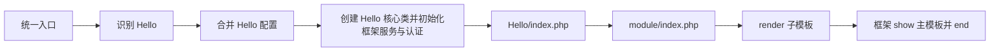

# 开发第一个 MyStepFW 应用

本教程面向第一次使用框架开发的人员。完成后，你会得到一个名为 `Hello` 的独立应用：能显示首页、读取查询参数、渲染模板，并提供一个自定义问候页面和 JSON API。

示例遵循当前框架接口，兼容 PHP 7.4，不建立业务表、不要求修改核心代码。先阅读 [应用编写规范](../../app/README.md) 和 [通用详细执行流程](../framework/execution.md)，了解目录归属、核心类约定及文件加载顺序。

## 1. 开始前的约定

- 框架已完成初始化，原有页面可以访问。
- PHP 可读应用文件，可写框架的配置、模板编译、会话和缓存目录。
- 示例名统一为 `Hello`，目录名、`info.php` 的 app 值、核心类名和核心类文件名保持一致；URL 中的应用名也保持相同大小写。
- 应用核心类位于自己的应用目录，声明 `class Hello extends myStep`；应用专属辅助文件也保存在应用目录内。
- 教程路径相对于网站根目录；`/Hello/` 表示站点根下的路径。子目录部署需要加部署前缀。
- 在没有为 Hello 单独绑定域名的情况下验证示例。框架已有强制绑定可能让 API 跳转到 API 域名，这是域名调度行为。

应用是一组由框架承接的页面和功能，不需要自己启动 Session、加载 Composer 或建立第二个入口。浏览器始终请求网站根目录的 `index.php`，不能直接访问 `app/Hello/index.php`。

## 2. 建立目录

先创建以下文件。`lib.php` 和 `route.php` 在后面的进阶步骤添加，其余文件构成可运行的最小页面。

```text
app/Hello/
├── Hello.class.php
├── info.php
├── config.php
├── plugin.php
├── index.php
├── module/
│   └── index.php
├── template/
│   ├── main.tpl
│   └── index.tpl
├── lib.php                 # 第 8 节添加
└── route.php               # 第 8 节添加
```

不要创建名为 `myStep` 的业务应用，也不要覆盖已有同名目录。

## 3. 描述应用并设置局部配置

### app/Hello/info.php

```php
<?php
return [
    'name' => '我的第一个应用',
    'app' => 'Hello',
    'ver' => '1.0.0',
    'intro' => '从页面、模板到路由和 API 的入门示例',
    'copyright' => 'Hello application',
];
```

`info.php` 是框架识别应用的重要条件。只创建目录、没有这个文件，不能可靠地通过路径首段选择应用。

### app/Hello/config.php

```php
<?php
return [
    'gen' => [
        'cache_page' => false,
    ],
    'web' => [
        'title' => 'Hello · 我的第一个应用',
        'minify' => false,
    ],
    'db' => [
        'auto' => false,
    ],
    'template' => [
        'name' => 'main',
        'path' => 'app/Hello/template/',
        'style' => '',
    ],
];
```

应用配置叠加在全局配置上，只写本应用需要覆盖的项目。`db.auto=false` 让本示例不自动连接数据库；框架会使用文件会话模式。关闭页面 HTML 缓存方便验证参数变化，但不代表关闭模板编译缓存。

### app/Hello/plugin.php

```php
<?php
return [];
```

先不引用插件，确保先把应用自身跑通。后续可以通过后台管理或维护这个数组接入已安装、已启用的插件。

## 4. 编写核心类和页面入口

### app/Hello/Hello.class.php

```php
<?php
/**
 * 功能说明：Hello 应用核心，继承框架资源和生命周期功能。
 * 使用说明：由框架按应用名自动加载和实例化。
 */
class Hello extends myStep
{
}
```

目录名、应用标识、核心类名和核心类文件名必须一致。即使当前没有扩展方法，也保留应用核心类；框架会把它实例化为当前请求的 `$mystep`。应用专属辅助类按需从本应用目录明确引入，不为自动加载而放进公用 `lib/`。

### app/Hello/index.php

```php
<?php
$module = $info_app['path'][0] ?? 'index';
if ($module === '') {
    $module = 'index';
}

// 第一版只开放首页；不把任意 URL 片段直接拼成 include 路径。
$allowed = ['index'];
if (!in_array($module, $allowed, true) || count($info_app['path']) > 1) {
    myStep::header('404');
}

$tpl = new myTemplate($tpl_setting, false);
$subSetting = $tpl_setting;
$subSetting['name'] = $module;
$tpl_sub = new myTemplate($subSetting, false);

require __DIR__.'/module/'.$module.'.php';
$content = $mystep->render($tpl_sub);
```

这里故意不调用 `show()` 和 `end()`：默认应用入口执行完毕后，外层 `go()` 会把 `$content` 赋给主模板的 `main`、显示页面并结束请求。入口重复显示一次，会造成重复输出。

模块白名单和路径段数检查可防止未知页面悄悄落入首页，也避免将用户输入用于任意文件包含。

## 5. 准备数据并渲染模板

### app/Hello/module/index.php

```php
<?php
$name = myReq::get('name', '!');
if (!is_string($name) || $name === '') {
    $name = '世界';
}
$name = mb_substr($name, 0, 40, 'UTF-8');

$tpl_sub->assign(
    'greeting',
    htmlspecialchars('你好，'.$name.'！', ENT_QUOTES, 'UTF-8')
);
$tpl_sub->assign('description', '这是由 MyStepFW 调度和渲染的第一个页面。');
```

这里使用 `myReq::get('name', '!')` 取得原始值，验证类型后在 HTML 输出时转义。默认的 `str` 读取模式已做 HTML 转义，混用会导致重复转义。查询参数可能是数组，例如 `?name[]=a`，所以不能假定所有输入都是字符串。模板变量默认不自动执行 HTML 转义；外部文本放进 HTML 前要根据输出位置转义。

### app/Hello/template/main.tpl

```html
<!DOCTYPE html>
<html lang="zh-CN">
<head>
    <meta charset="utf-8">
    <meta name="viewport" content="width=device-width, initial-scale=1">
    <title><!--web_title--></title>
    <!--page_start-->
</head>
<body>
    <main>
        <!--main-->
    </main>
    <!--page_end-->
</body>
</html>
```

### app/Hello/template/index.tpl

```html
<h1><!--greeting--></h1>
<p><!--description--></p>
```

框架变量占位符使用 `<!--变量名-->`。主模板的 `<!--main-->` 接收已经渲染的子模板；`<!--page_start-->` 和 `<!--page_end-->` 接收控制器收集的资源与附加内容。

模板中不需要启用 PHP 脚本执行。业务数据放在 PHP 模块，展示结构放在模板，能够让后续修改更清晰。

## 6. 第一次访问

使用当前站点地址加以下路径：

| 请求 | 预期 |
| --- | --- |
| `/Hello/` | 显示“你好，世界！” |
| `/Hello/?name=开发者` | 显示“你好，开发者！” |
| `/Hello/index?name=开发者` | 同样进入首页 |
| `/Hello/missing` | HTTP 404 |
| `/Hello/?name[]=a` | 使用默认名称，不产生类型错误 |

尚未配置 rewrite 时，也可使用 `/index.php?/Hello/&name=开发者` 或 `/index.php/Hello/?name=开发者` 验证。不要通过访问应用目录中的 PHP 文件来绕过统一入口。

最小页面调用关系如下：



应用目录存在后不需要写一条“注册应用”的数据库记录。后台应用管理会扫描应用目录；新增路由源后，动态请求会检查并更新编译表。

## 7. 认识请求中可以使用的对象

| 名称 | 用途 |
| --- | --- |
| `$ms_setting` | 已合并的运行配置 |
| `$info_app` | 承接应用、路径段、查询参数及当前 route |
| `$mystep` | 当前控制器，可 render、show、注册标签和钩子 |
| `$tpl_setting` | 当前模板名称、路径、样式和编译目录 |
| `$tpl_cache` | 页面缓存参数；本示例禁用 |
| `$db`、`$cache` | 框架服务对象；存在不代表已自动连接数据库 |
| `PATH`、`ROOT_WEB` | 当前应用磁盘目录、网站 Web 根路径 |

这些变量在应用入口的包含作用域中可用；进入自己定义的函数时，要用 `global` 明确引入，或通过参数传递。带命名空间的代码引用框架类时使用 `\myTemplate`、`\myReq` 等完整类名。

## 8. 添加自定义页面和 API

现在增加两个文件；最小页面中的其他文件保持原样。

### app/Hello/route.php

```php
<?php
$rule = [
    ['/Hello/hi/[str]', 'app\\Hello\\greet'],
];

$api = [
    'ping' => 'app\\Hello\\ping',
];
```

### app/Hello/lib.php

```php
<?php
namespace app\Hello;

function greet($name = 'World')
{
    global $mystep, $tpl_setting;

    $name = trim($name, '/');
    $tpl = new \myTemplate($tpl_setting, false);
    $subSetting = $tpl_setting;
    $subSetting['name'] = 'index';
    $sub = new \myTemplate($subSetting, false);
    $sub->assign('greeting', htmlspecialchars('你好，'.$name.'！', ENT_QUOTES, 'UTF-8'));
    $sub->assign('description', '这个页面来自自定义路由。');
    $tpl->assign('main', $mystep->render($sub));
    $mystep->show($tpl);
    // 路由处理器正常返回，由外层 go() 调用 end()。
}

function ping(...$unused)
{
    // 当前 API 层的默认头不一定是 JSON，明确设置。
    header('Content-Type: application/json; charset=utf-8');
    return ['ok' => true, 'app' => 'Hello', 'message' => 'pong'];
}
```

`lib.php` 在完整初始化阶段加载，供路由回调和页面复用。不要在这里直接 `echo` 调试信息，它也会影响 API 输出。

| 请求 | 预期 |
| --- | --- |
| `/Hello/hi/Alice` | 自定义页面显示“你好，Alice！” |
| `/api/Hello/ping/json` | JSON 对象，包含 `ok: true` 和 `message: pong` |
| `/api/Hello/ping/json?probe=1` | 本示例忽略额外参数，仍返回 pong |

`[str]` 默认匹配 `\w+`，不是任意名称；这个 URL 示例使用 ASCII 名称。中文名称使用前面首页的查询参数示例即可。

自定义规则优先于应用默认入口，所以 `/Hello/hi/Alice` 不会被首页模块白名单拒绝。API 规则由框架分发，`$api` 的键是方法名，分组名自动来自应用目录。

当前 API 实现会把 GET/POST 与路径值按位置传给方法，部分形式还保留格式参数；这里使用可变参数且不消费外部数据，避免初学阶段混淆。业务 API 应明确校验参数类型、数量、方法和授权，返回所需字段，不要返回整个配置对象。

路由源会被编译到 `config/route.php`。只改自己的 `route.php`，不要把生成文件作为开发入口。路由源不应执行有副作用的初始化代码，因为它不保证每次请求都被包含。

## 9. 为敏感页面加权限中间件

这一步是可选扩展。在 `route.php` 的 `$rule` 数组追加：

```php
['/Hello/private/[str]', ['app\\Hello\\requireAdmin', 'app\\Hello\\privatePage']],
```

在 `lib.php` 的同一命名空间中追加：

```php
function requireAdmin($previous = true)
{
    if (\myReq::session('sysop') !== 'y') {
        http_response_code(403);
        header('Content-Type: text/plain; charset=utf-8');
        echo '需要管理员身份';
        return false;
    }
    return true;
}

function privatePage($path, array $results)
{
    header('Content-Type: text/plain; charset=utf-8');
    echo '管理员页面：'.trim($path, '/');
}
```

匿名访问 `/Hello/private/demo` 应得到 403。这只是框架管理员身份示例，不是完整角色权限系统。业务权限要按自己的用户、角色和资源规则处理。

流水线最后一项接收的是“捕获值拼成的路径”和“中间件结果数组”，与单处理器逐个接收捕获值不同。返回严格 `false` 会阻止最终处理器，但不会自动补正文或状态，因此中间件需自行输出拒绝响应。

## 10. 继续扩展应用

### 新页面和静态资源

增加普通页面时，把固定模块名加入 `$allowed`，再创建对应 `module/{name}.php` 和 `template/{name}.tpl`。不要移除白名单后直接 include 用户路径。

`asset/style.css` 与 `asset/function.js` 会被框架收集。其他资源可以放在 `asset/` 下，并通过应用资源路径访问，例如 `/Hello/asset/images/logo.png`；嵌套路径会受真实目录边界和扩展名限制。

通过 `myStep::setURL('Hello/')` 生成链接，并在 HTML 属性中用 `htmlspecialchars(..., ENT_QUOTES, 'UTF-8')` 转义。硬编码 `/Hello/` 只适合根路径部署的演示。

### 扩展 Hello.class.php

应用已提供同名核心类 `Hello.class.php`，并声明 `class Hello extends myStep`。需要 `preload()`、`shutdown()` 或应用公共方法时，在这个类中扩展；具体页面仍按模块及对应模板拆分，保持每个功能独立维护。

`preload()` 发生在默认会话启动和登录恢复之前，适合准备服务，不能假定身份已恢复。重写 `start()` 或 `end()` 会影响整个生命周期，应先理解父类行为。

### 接入数据库

业务需要数据库时，把应用的 `db.auto` 调整为 `true`，使用环境配置中的连接信息；表结构通过明确的安装或迁移步骤维护。页面访问和 `lib.php` 加载不应自动建表。

本教程不写数据库口令，也不提供未经定义表结构的查询示例。查询值使用框架查询构造接口并做好类型校验；表名、字段名、排序项等标识符使用固定值或白名单。

## 11. 验证与常见问题

先用 PHP 7.4 对新增 PHP 文件执行 `php -l 文件路径`，再按第 6、8 节访问。额外验证 `<script>` 等参数只显示为文本、未知页面是 404，以及未登录访问敏感页面是 403。

| 现象 | 优先检查 |
| --- | --- |
| 仍进入默认入口 | info.php 是否存在，app 值与目录大小写是否一致 |
| 模板为空 | template.name/path/style 与实际文件位置是否对应 |
| 名称含 HTML 后页面异常 | 是否对外部文本做了输出转义 |
| handler 不可调用 | 命名空间、回调字符串、lib.php 是否正确，是否误写了单反斜杠字符串 |
| 路由新增后未生效 | 编辑的是否是源文件，config 是否可写，是否被更早规则命中 |
| 页面显示两遍 | 默认入口是否又自行 show，或重复调用 end |
| API 前出现调试文字 | lib.php、preload、start 钩子是否意外输出 |
| 访问 API 跳到其他域名 | 域名绑定和强制绑定设置，不能靠修改业务回调解决 |
| 接入插件后没有效果 | 参见 [第一个插件](first-plugin.md) 的启用条件 |

清理教程应用时，先解除插件引用与相关域名/默认入口绑定，再移除 `app/Hello/`；路由编译表会在后续请求同步。若后来加入业务数据，不要把移除代码目录当成数据卸载方案。

## 12. 示例核验

本教程与插件教程的完整文件示例已从文档提取，在临时目录使用实际框架核心和 PHP 7.4 验证。应用场景覆盖首页、查询参数、数组输入、HTML 转义、未知页面、自定义路由、JSON API 及匿名权限拒绝。验证未把示例安装到正式站点；浏览器资源加载和真实身份登录仍需开发者按自己的环境验证。

## 写请求的框架保护

框架在会话启动后统一检查非安全 HTTP 方法的 CSRF 令牌。通过标准页面输出的 POST 表单和内置 Ajax 会自动携带；独立客户端先用同一 Cookie 会话访问 `/ms_csrf` 或框架 `csrf` API，再用 `X-CSRF-Token` 提交。跨应用时获取目标应用令牌。令牌不替代业务权限，所有状态修改应使用 POST。直接输出页面、外部回调及自定义 API 请按 [核心与调用入口完善记录](../framework/security-attachments.md) 集成。
